<div align="center">

# Motion Story

**An agent-ready library for motion graphics that tell a story — not a slideshow.**

Educational shorts · visual explainers · data storytelling · product demos · kinetic typography

[](SKILL.md) [](styles/catalog.json) [](LICENSE)

**[Style gallery](#style-gallery) · [Workflow](#workflow) · [Example prompts](#example-prompts) · [Multi-agent setup](#multi-agent-setup) · [Install & use](#install--use) · [FAQ](#faq)**

</div>

> Motion Story uses original visual systems informed by research into short-form storytelling. The [Bang Motion](https://github.com/bangtutorial/bang-motion) project helped inspire the anti-slideshow approach; these assets and implementations are independently authored. A good style is **not a guarantee of virality**.

## Why

Most automatic motion graphics are slides with transitions: headline appears, fades away, another headline appears. Motion Story instead asks for a **continuous visual argument**, where subjects, diagrams, and camera movement follow an evolving idea. Each style defines a motif, hook, palette, evidence visualization, and motion grammar so an AI coding agent can turn a topic into a coherent animation.

## What you can make

| Content | Recommended styles |
|---|---|
| AI / tech / educational explainers | Storyflow, Myth Breaker |
| Surprising science and everyday facts | Curiosity Lab |
| Economy, statistics and comparisons | Data Shock |
| Historical narratives and human stories | Micro Drama |
| Gadgets, product demos and affiliate explainers | Product X-Ray |

## Style gallery

**The pictures below are static concept/keyframes, not finished videos.** The library currently includes **30 named styles**. Click a card's style guide for its visual vocabulary. The animated [browser preview](styles/preview.html) is an independent 12-second reference; future production prompts should build a new story rather than simply animate these static images.

<table>
<tr>
<td width="50%" valign="top"><a href="styles/storyflow/STYLE.md">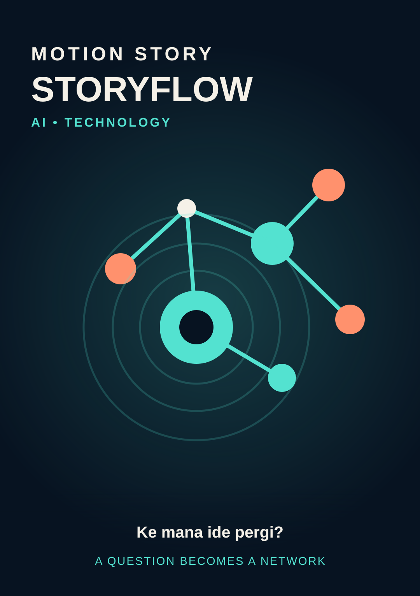</a><br><strong><a href="styles/storyflow/STYLE.md">01 — Storyflow</a></strong><br>Living Narrative Motion<br><sub>AI · technology · education. Signal orb, connections, connected proofs, camera push-through.</sub><br><br><strong>Hook:</strong> “Ke mana pertanyaanmu pergi saat memakai AI?”</td>
<td width="50%" valign="top"><a href="styles/curiosity-lab/STYLE.md">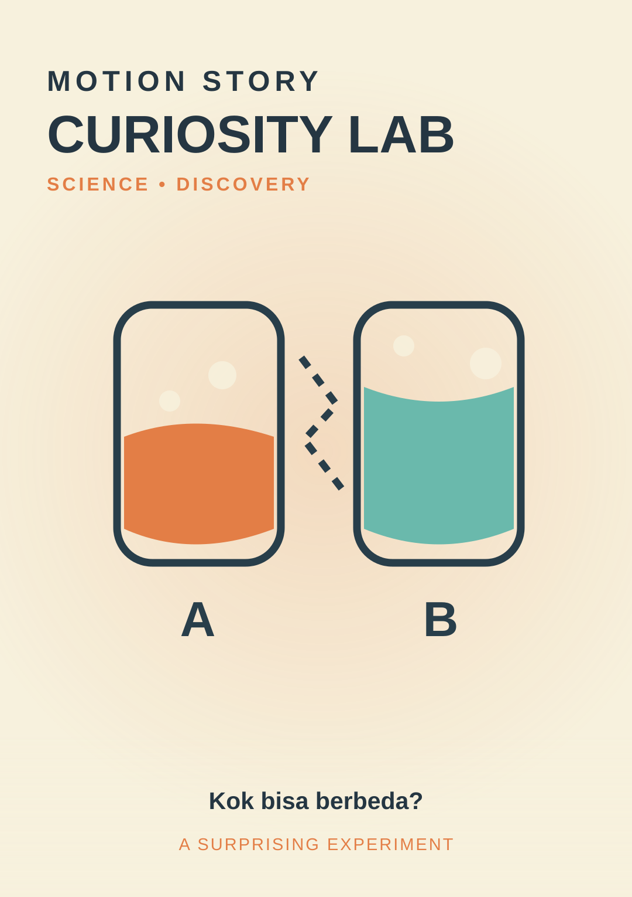</a><br><strong><a href="styles/curiosity-lab/STYLE.md">02 — Curiosity Lab</a></strong><br>Experiment & Discovery<br><sub>Science · unusual facts. Side-by-side experiment, cause–effect, explanatory annotations.</sub><br><br><strong>Hook:</strong> “Kenapa dua gelas ini mencair berbeda?”</td>
</tr>
<tr>
<td width="50%" valign="top"><a href="styles/data-shock/STYLE.md">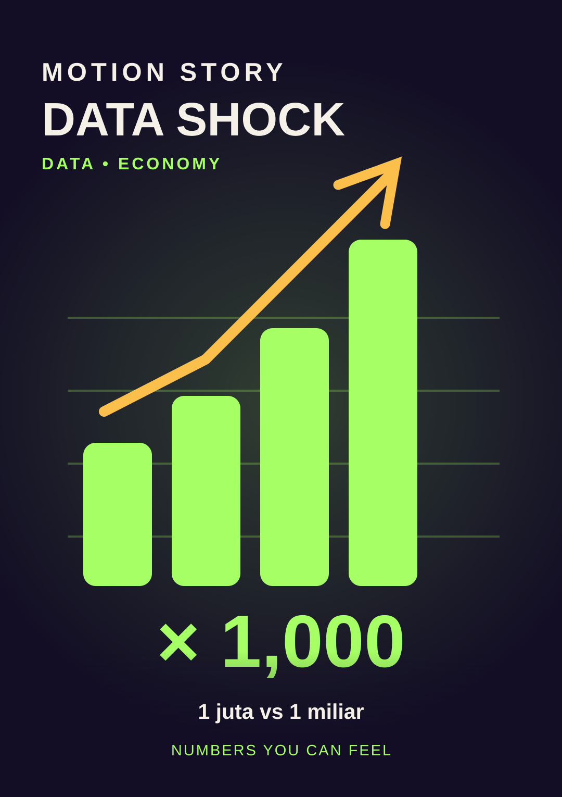</a><br><strong><a href="styles/data-shock/STYLE.md">03 — Data Shock</a></strong><br>Numbers & Insights<br><sub>Technology · economy · statistics. Number morphs and meaningful animated comparisons.</sub><br><br><strong>Hook:</strong> “Seberapa beda satu juta dan satu miliar detik?”</td>
<td width="50%" valign="top"><a href="styles/myth-breaker/STYLE.md">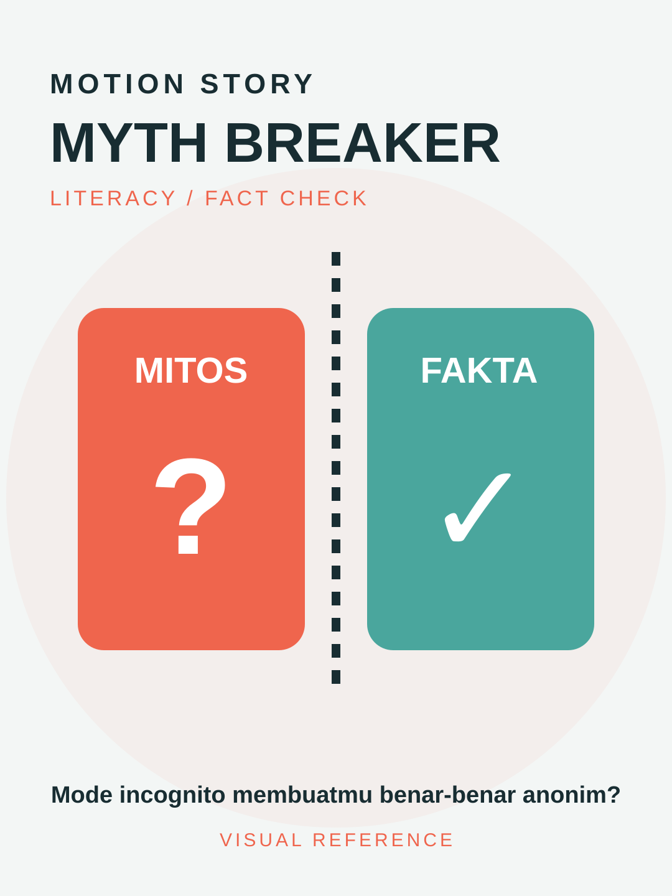</a><br><strong><a href="styles/myth-breaker/STYLE.md">04 — Myth Breaker</a></strong><br>Belief vs Evidence<br><sub>Digital literacy · consumer education. Visual split, test, proof, nuanced conclusion.</sub><br><br><strong>Hook:</strong> “Mode incognito bikin kamu anonim?”</td>
</tr>
<tr>
<td width="50%" valign="top"><a href="styles/micro-drama/STYLE.md">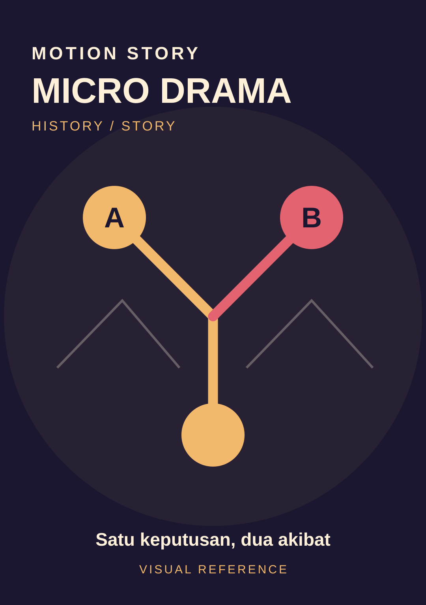</a><br><strong><a href="styles/micro-drama/STYLE.md">05 — Micro Drama</a></strong><br>Cinematic Storytelling<br><sub>History · biography · life. Character choices, emotional stakes, branching visual narratives.</sub><br><br><strong>Hook:</strong> “Satu keputusan kecil mengubah semuanya.”</td>
<td width="50%" valign="top"><a href="styles/product-xray/STYLE.md">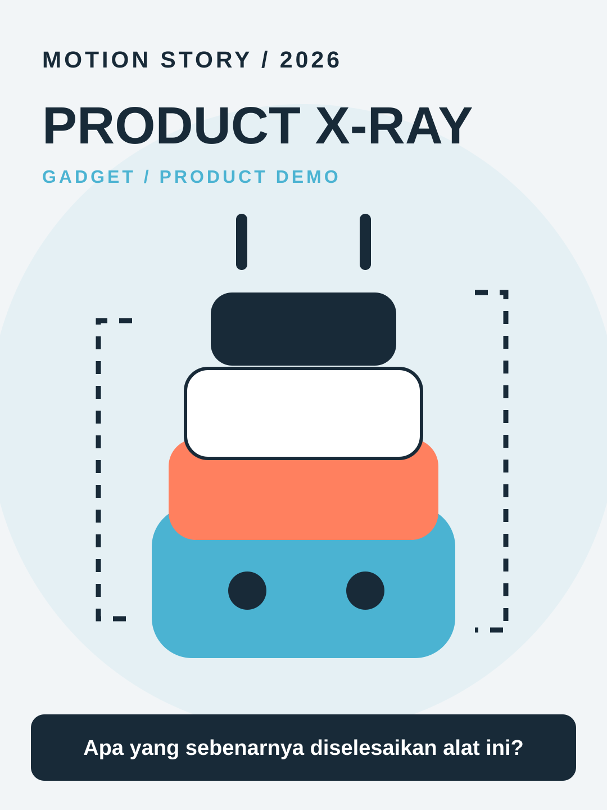</a><br><strong><a href="styles/product-xray/STYLE.md">06 — Product X-Ray</a></strong><br>Product Mechanism & Demo<br><sub>Gadgets · comparisons · affiliate. Exploded components, mechanism reveal, honest trade-offs.</sub><br><br><strong>Hook:</strong> “Apa yang sebenarnya dilakukan alat ini?”</td>
</tr>
</table>


### Five additional styles

These are original, lightweight **SVG style illustrations** added to the repository. The previously generated photoreal poster PNGs are not included in this commit. These frames are art direction for building motion, not motion exports.

<table>
<tr><td width="50%" valign="top"><a href="styles/kinetic-burst/STYLE.md">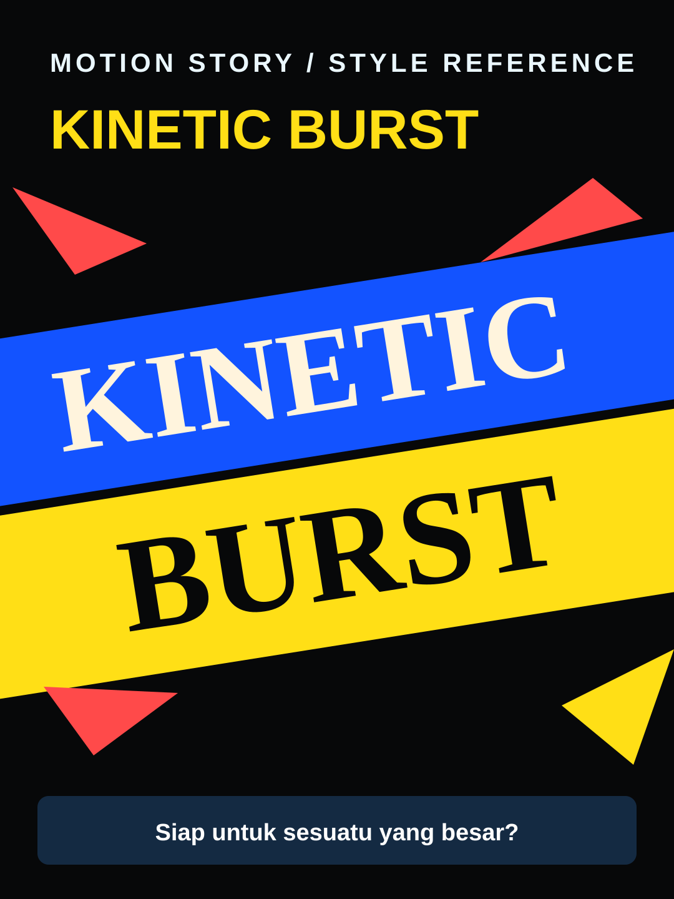</a><br><strong><a href="styles/kinetic-burst/STYLE.md">Kinetic Burst</a></strong><br><sub>Events · launches · music. Words explode into motion; a headline is the subject.</sub><br><br><strong>Hook:</strong> “Siap untuk sesuatu yang besar?”</td><td width="50%" valign="top"><a href="styles/isometric-flow/STYLE.md">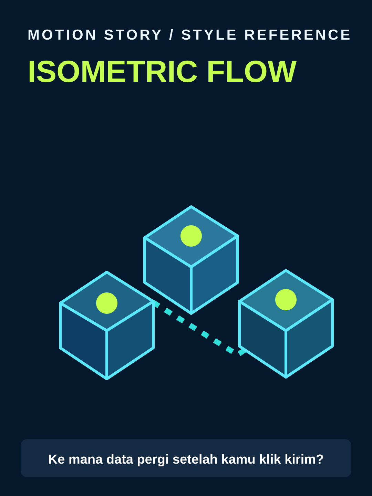</a><br><strong><a href="styles/isometric-flow/STYLE.md">Isometric Flow</a></strong><br><sub>SaaS · systems · AI. Isometric modules connected by a journey from input to output.</sub><br><br><strong>Hook:</strong> “Ke mana data pergi setelah klik kirim?”</td></tr>
<tr><td width="50%" valign="top"><a href="styles/editorial-cutout/STYLE.md">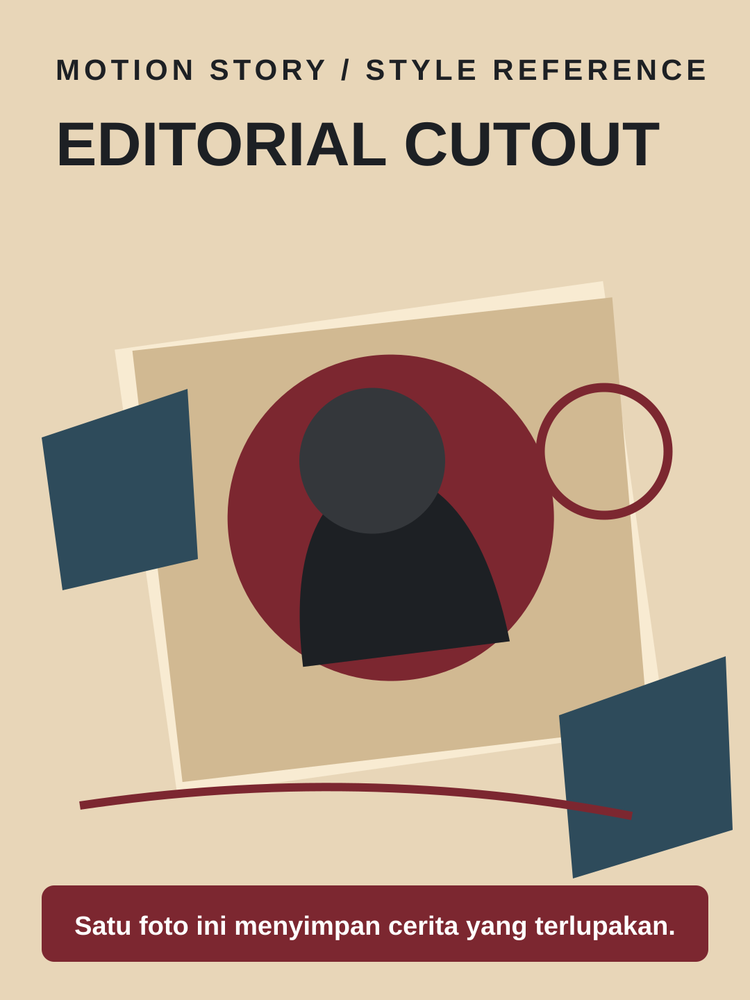</a><br><strong><a href="styles/editorial-cutout/STYLE.md">Editorial Cutout</a></strong><br><sub>History · documentary. Archival paper collage, human stories and animated evidence.</sub><br><br><strong>Hook:</strong> “Satu foto menyimpan cerita apa?”</td><td width="50%" valign="top"><a href="styles/blueprint-mechanism/STYLE.md">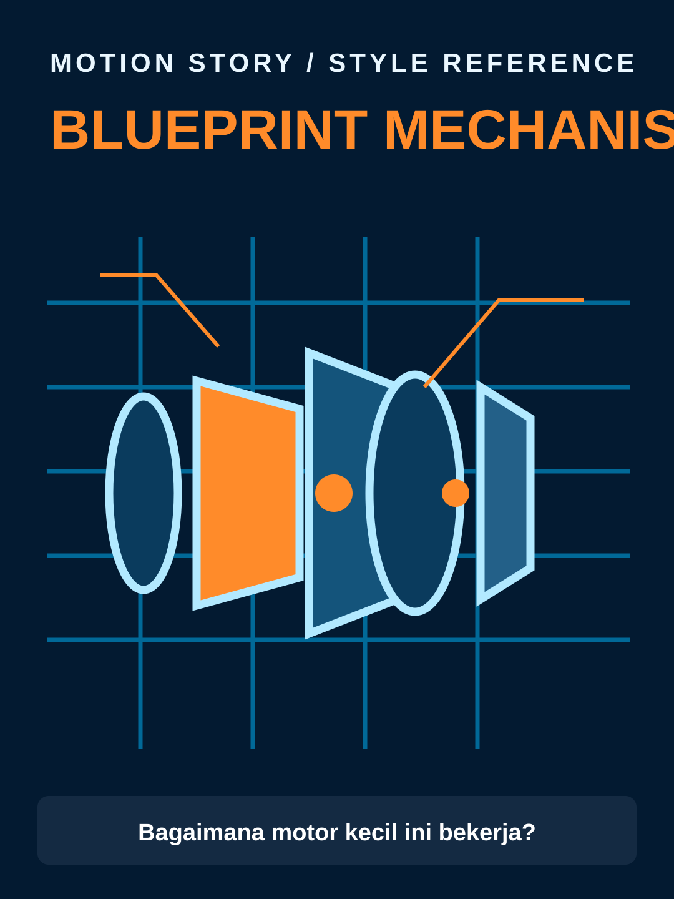</a><br><strong><a href="styles/blueprint-mechanism/STYLE.md">Blueprint Mechanism</a></strong><br><sub>Engineering · gadgets. Exploded technical components, dimension callouts and assembly.</sub><br><br><strong>Hook:</strong> “Bagaimana mesin ini bekerja?”</td></tr>
<tr><td width="50%" valign="top"><a href="styles/playful-doodle/STYLE.md">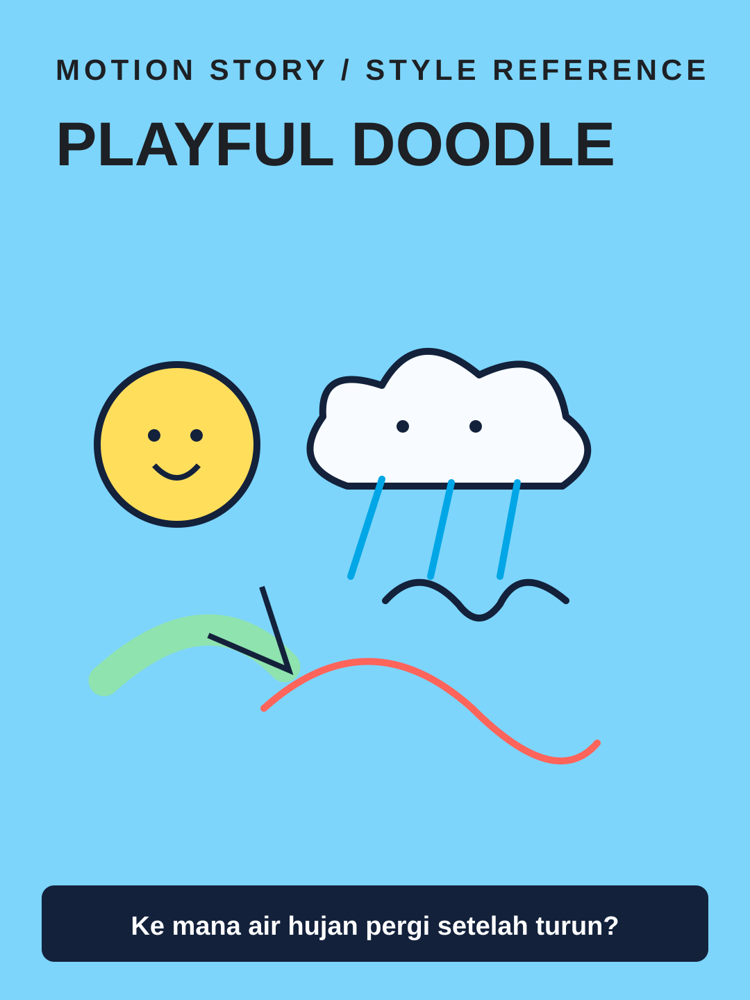</a><br><strong><a href="styles/playful-doodle/STYLE.md">Playful Doodle</a></strong><br><sub>Kids · education · facts. Hand-drawn characters, arrows and cheerful causal diagrams.</sub><br><br><strong>Hook:</strong> “Ke mana air hujan pergi?”</td><td width="50%" valign="top"><strong>How to animate these references</strong><br><br>Choose the style name, open the matching style guide, and build continuous motion with an evolving scene. Every new style includes a copy-ready prompt.<br><br><a href="docs/MOTION_GUIDE.md">Motion generation workflow</a></td></tr>
</table>


### Eight new style references

The visual references are original static SVG illustrations. They describe art direction; the agent must reconstruct animated subjects and scenes rather than zooming a single static image.

<table>
<tr><td width="50%" valign="top"><a href="styles/vintage/STYLE.md">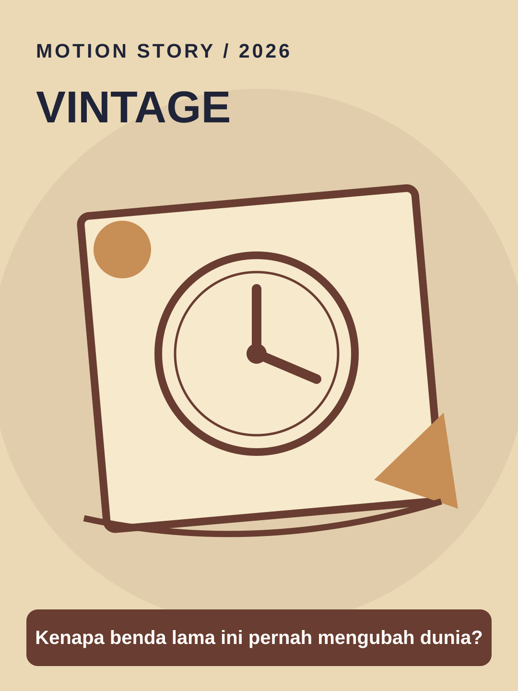</a><br><strong><a href="styles/vintage/STYLE.md">Vintage</a></strong><br><sub>History · nostalgia — Archival paper, postcards and ink marks.</sub><br><br><strong>Hook:</strong> “Kenapa benda lama ini mengubah dunia?”</td><td width="50%" valign="top"><a href="styles/modern/STYLE.md">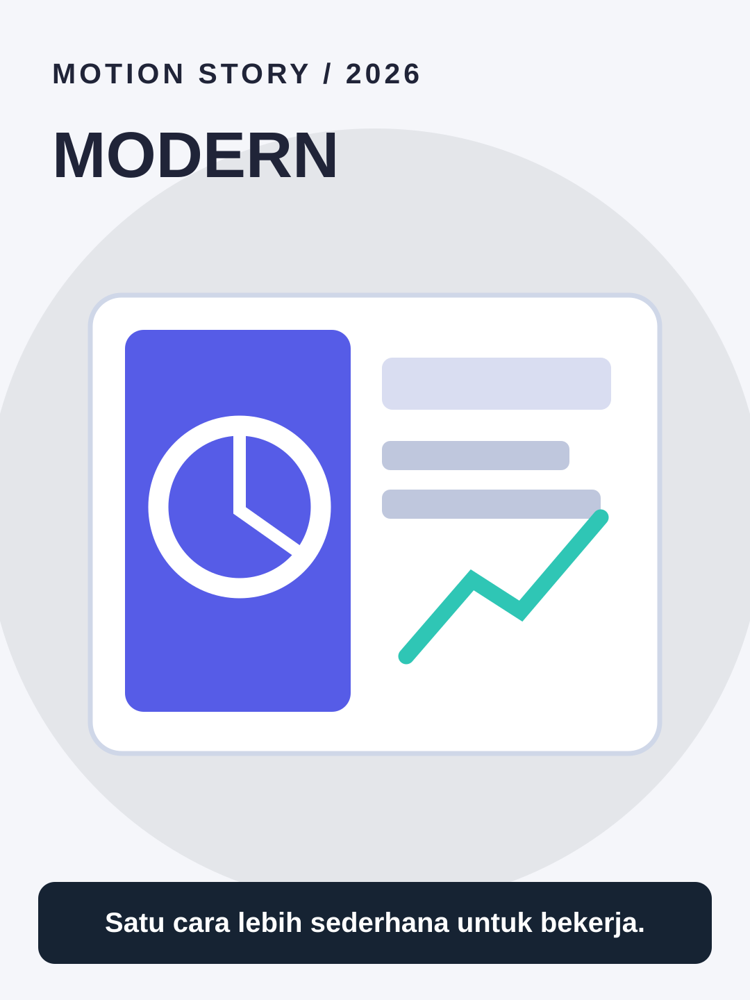</a><br><strong><a href="styles/modern/STYLE.md">Modern</a></strong><br><sub>Tech · lifestyle — Clean product-first layout and precise editorial motion.</sub><br><br><strong>Hook:</strong> “Satu cara lebih sederhana bekerja.”</td></tr>
<tr><td width="50%" valign="top"><a href="styles/product-review/STYLE.md">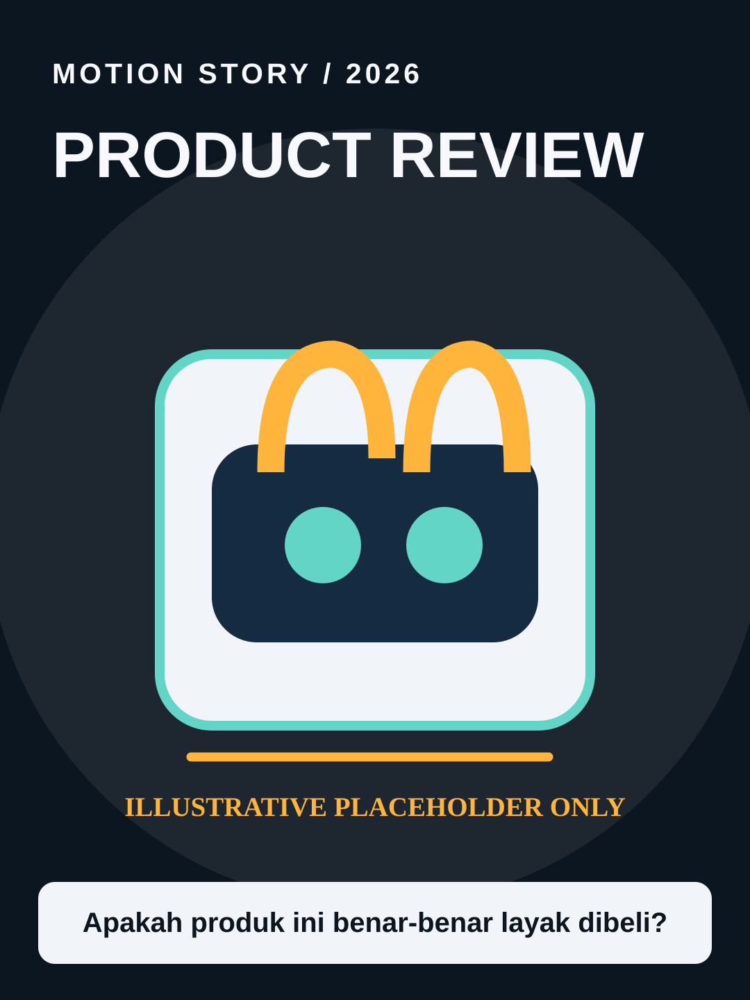</a><br><strong><a href="styles/product-review/STYLE.md">Product Review</a></strong><br><sub>Affiliate · genuine reviews — Real supplied product photo, demo and balanced verdict.</sub><br><br><strong>Hook:</strong> “Layak dibeli atau tidak?”</td><td width="50%" valign="top"><a href="styles/cartoon/STYLE.md">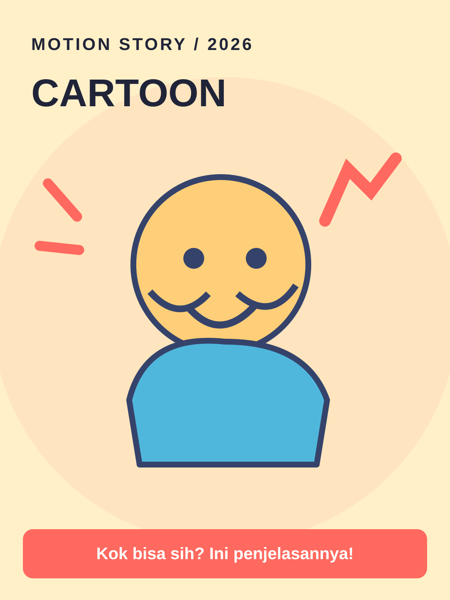</a><br><strong><a href="styles/cartoon/STYLE.md">Cartoon</a></strong><br><sub>Education · family — Expressive 2D character acting and playful dynamics.</sub><br><br><strong>Hook:</strong> “Kok bisa begitu?”</td></tr>
<tr><td width="50%" valign="top"><a href="styles/manga/STYLE.md">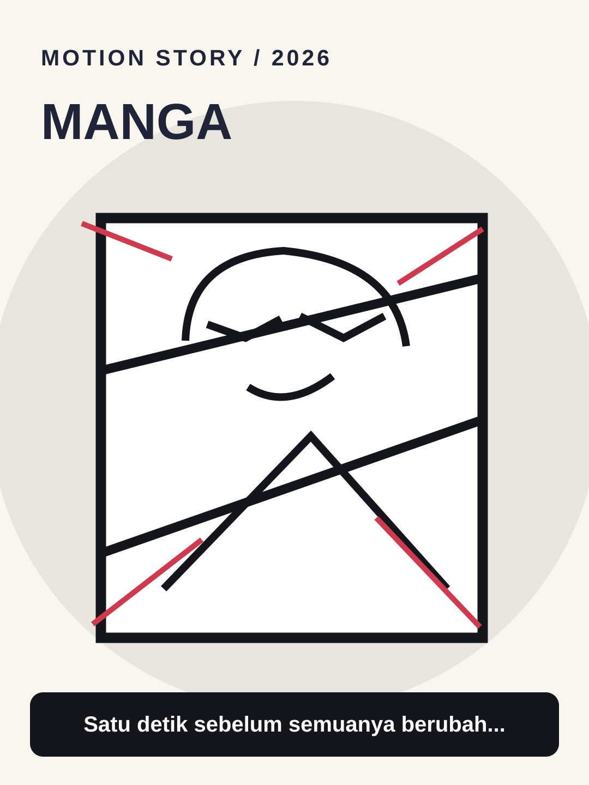</a><br><strong><a href="styles/manga/STYLE.md">Manga</a></strong><br><sub>Action · storytelling — Ink panels, dramatic reveal and screentone.</sub><br><br><strong>Hook:</strong> “Satu detik sebelum berubah...”</td><td width="50%" valign="top"><a href="styles/pixel/STYLE.md">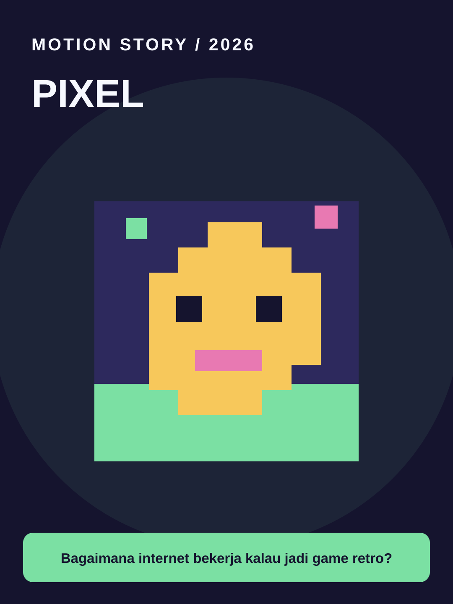</a><br><strong><a href="styles/pixel/STYLE.md">Pixel</a></strong><br><sub>Retro · gaming — Pixel sprites, tile worlds and stepped motion.</sub><br><br><strong>Hook:</strong> “Kalau internet jadi game retro?”</td></tr>
<tr><td width="50%" valign="top"><a href="styles/roblox/STYLE.md">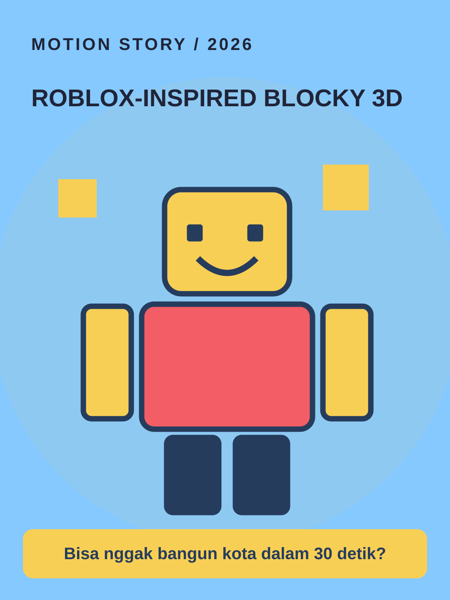</a><br><strong><a href="styles/roblox/STYLE.md">Roblox-Inspired Blocky 3D</a></strong><br><sub>Game · virtual worlds — Original blocky characters and modular world-building.</sub><br><br><strong>Hook:</strong> “Bisa bangun kota 30 detik?”</td><td width="50%" valign="top"><a href="styles/game/STYLE.md">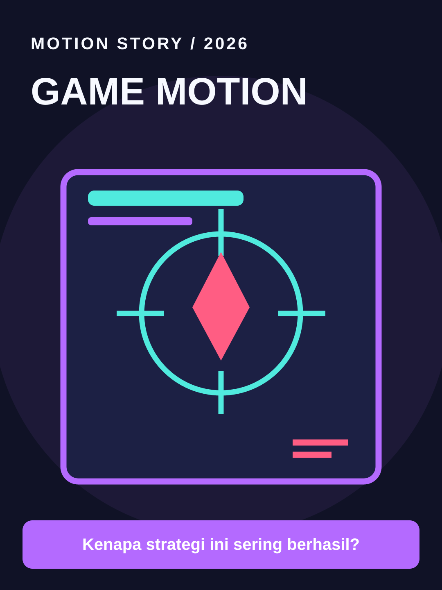</a><br><strong><a href="styles/game/STYLE.md">Game Motion</a></strong><br><sub>Esports · explainers — Game HUD, camera action and clear mechanics.</sub><br><br><strong>Hook:</strong> “Kenapa strategi ini berhasil?”</td></tr>
</table>

### Eleven Bang Motion–inspired styles

Eleven further styles modeled on the style gallery of [Bang Motion](https://github.com/bangtutorial/bang-motion) — its opener, promo and explainer looks, rebuilt here as original Motion Story references with Indonesian hooks. Same rule as the rest of the library: the SVG is art direction to rebuild as motion, not a slide to zoom.

<table>
<tr><td width="50%" valign="top"><a href="styles/grainy-gradient/STYLE.md">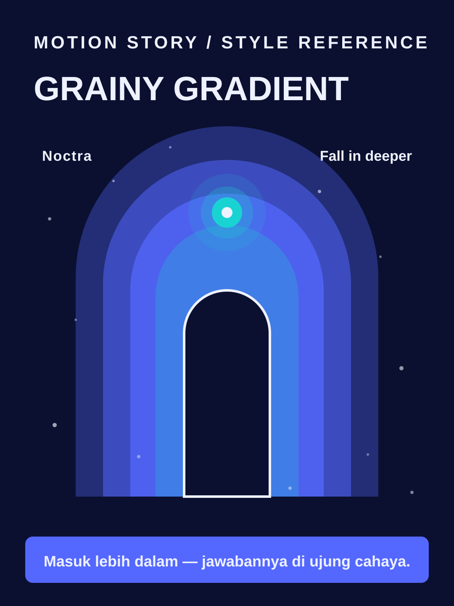</a><br><strong><a href="styles/grainy-gradient/STYLE.md">Grainy Gradient</a></strong><br><sub>Technology · AI · music. Glowing layered shapes and fine grain; the camera travels through them.</sub><br><br><strong>Hook:</strong> “Masuk lebih dalam — jawabannya di ujung cahaya.”</td><td width="50%" valign="top"><a href="styles/poster-colorblock/STYLE.md">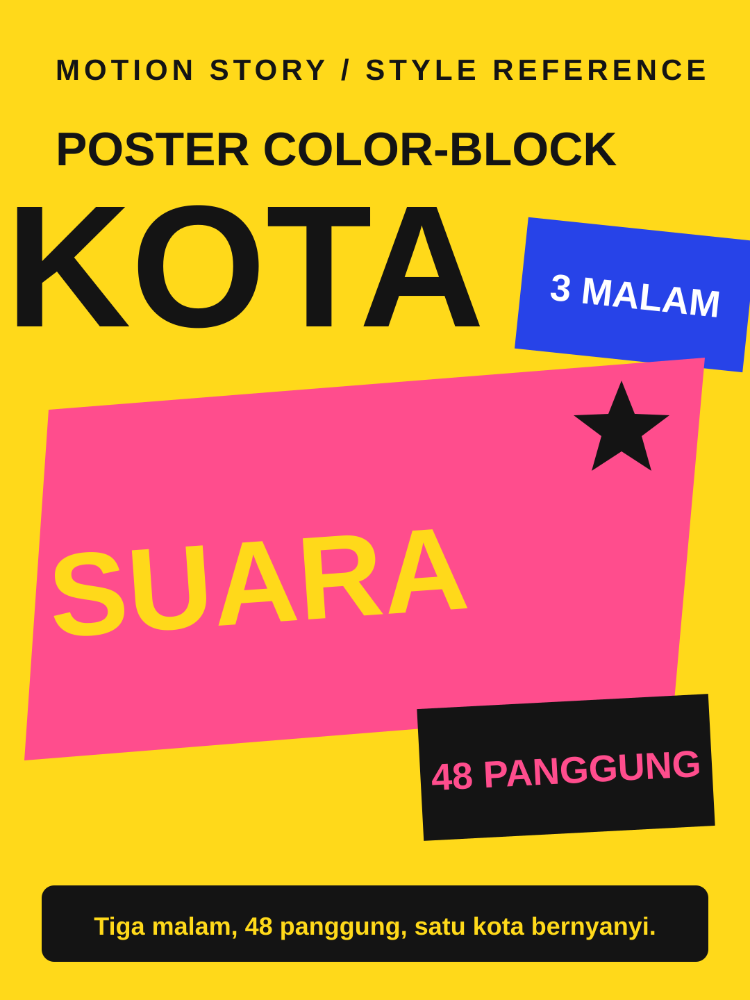</a><br><strong><a href="styles/poster-colorblock/STYLE.md">Poster Color-Block</a></strong><br><sub>Events · music · launches. Huge cropped words; solid color fields slam in on the beat.</sub><br><br><strong>Hook:</strong> “Tiga malam, 48 panggung, satu kota bernyanyi.”</td></tr>
<tr><td width="50%" valign="top"><a href="styles/product-tour/STYLE.md">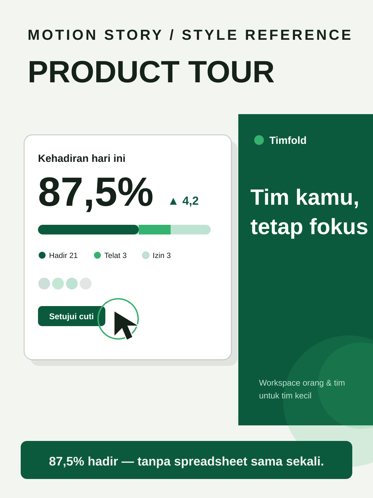</a><br><strong><a href="styles/product-tour/STYLE.md">Product Tour</a></strong><br><sub>SaaS · dashboards · B2B. Real UI lifted out of the dashboard; the camera zooms into what gets clicked.</sub><br><br><strong>Hook:</strong> “87,5% hadir — tanpa spreadsheet sama sekali.”</td><td width="50%" valign="top"><a href="styles/flat-vector/STYLE.md">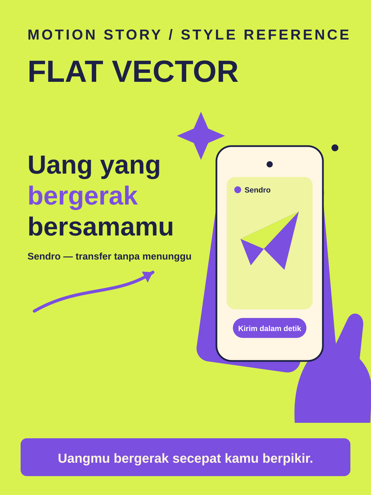</a><br><strong><a href="styles/flat-vector/STYLE.md">Flat Vector</a></strong><br><sub>Fintech · consumer apps. Solid fills, stylized hands and flat-drawn UI with gentle overshoot.</sub><br><br><strong>Hook:</strong> “Uangmu bergerak secepat kamu berpikir.”</td></tr>
<tr><td width="50%" valign="top"><a href="styles/flat-pop-photo/STYLE.md">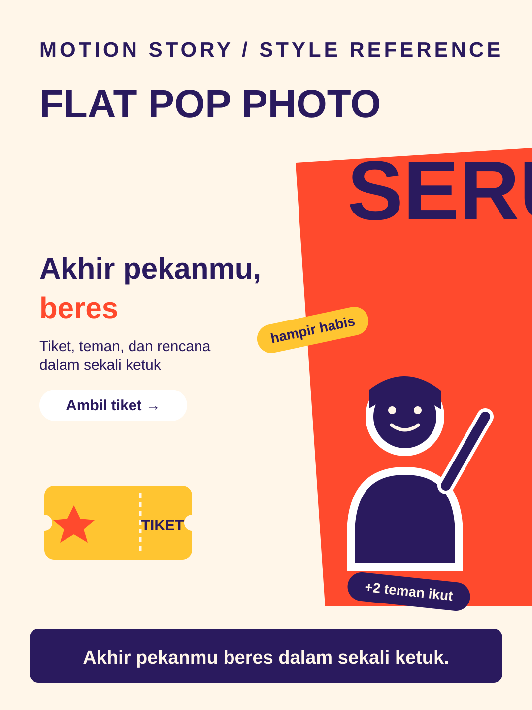</a><br><strong><a href="styles/flat-pop-photo/STYLE.md">Flat Pop Photo</a></strong><br><sub>Consumer apps · campaigns. Photo cutouts pop in with stickers; brand color fields snap on a visible trigger.</sub><br><br><strong>Hook:</strong> “Akhir pekanmu beres dalam sekali ketuk.”</td><td width="50%" valign="top"><a href="styles/continuous-action/STYLE.md">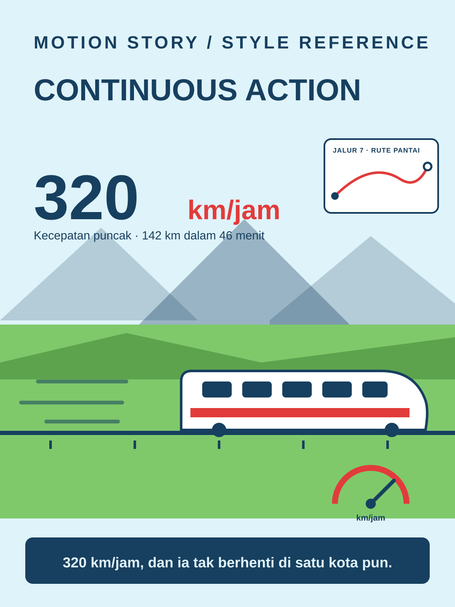</a><br><strong><a href="styles/continuous-action/STYLE.md">Continuous Action</a></strong><br><sub>Transport · logistics · processes. One subject that never stops; numbers and maps live inside the world.</sub><br><br><strong>Hook:</strong> “320 km/jam, dan ia tak berhenti di satu kota pun.”</td></tr>
<tr><td width="50%" valign="top"><a href="styles/visual-journalism/STYLE.md">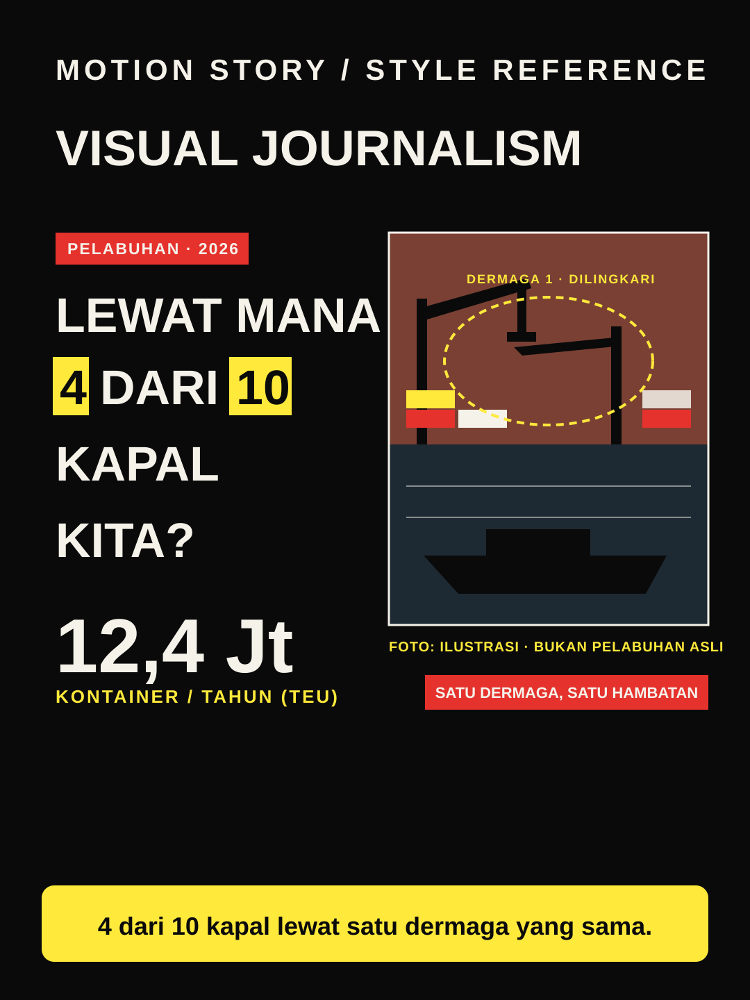</a><br><strong><a href="styles/visual-journalism/STYLE.md">Visual Journalism</a></strong><br><sub>News · current issues · documentary. Black ground, real photos with source tags, highlighter and dashed annotations.</sub><br><br><strong>Hook:</strong> “4 dari 10 kapal lewat satu dermaga yang sama.”</td><td width="50%" valign="top"><a href="styles/white-catalog/STYLE.md">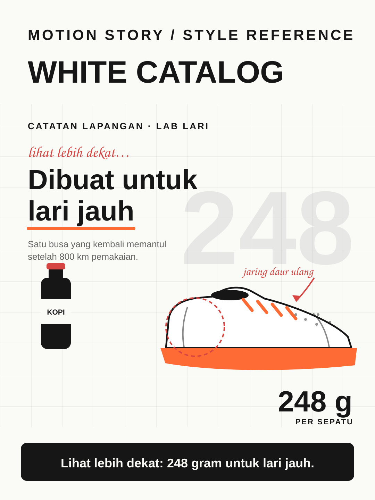</a><br><strong><a href="styles/white-catalog/STYLE.md">White Catalog</a></strong><br><sub>Products · brands · reviews. White grid, product cutouts, handwritten notes beside heavy sans type.</sub><br><br><strong>Hook:</strong> “Lihat lebih dekat: 248 gram untuk lari jauh.”</td></tr>
<tr><td width="50%" valign="top"><a href="styles/vintage-sketch/STYLE.md">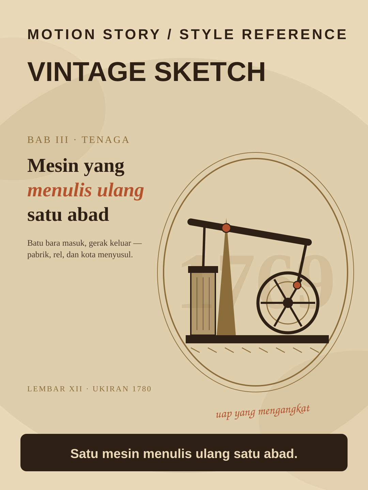</a><br><strong><a href="styles/vintage-sketch/STYLE.md">Vintage Sketch</a></strong><br><sub>History · biography · education. Sepia paper, engraving art, classic serifs and rust notes.</sub><br><br><strong>Hook:</strong> “Satu mesin menulis ulang satu abad.”</td><td width="50%" valign="top"><a href="styles/cartoon-collage/STYLE.md">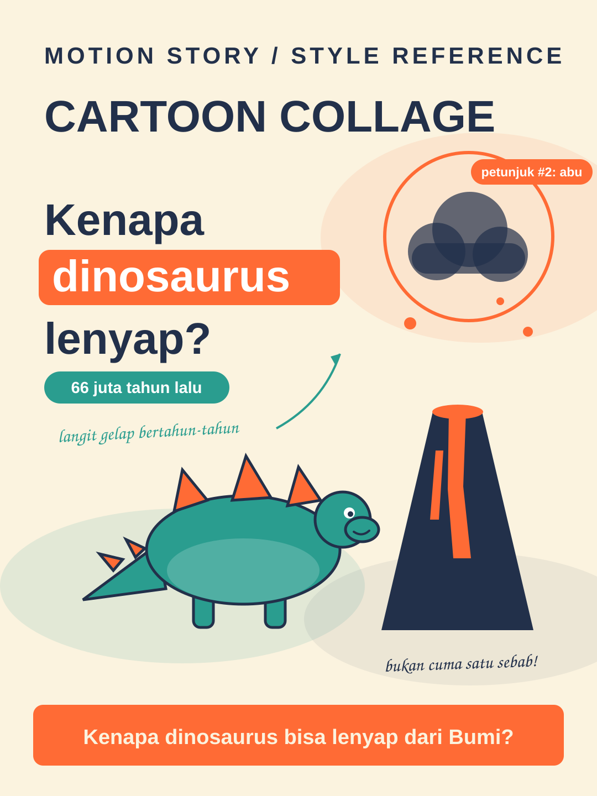</a><br><strong><a href="styles/cartoon-collage/STYLE.md">Cartoon Collage</a></strong><br><sub>Science · education · kids. Cream paper, flat illustration cutouts, color pills and handwriting.</sub><br><br><strong>Hook:</strong> “Kenapa dinosaurus bisa lenyap dari Bumi?”</td></tr>
<tr><td width="50%" valign="top"><a href="styles/cartoon-stage/STYLE.md">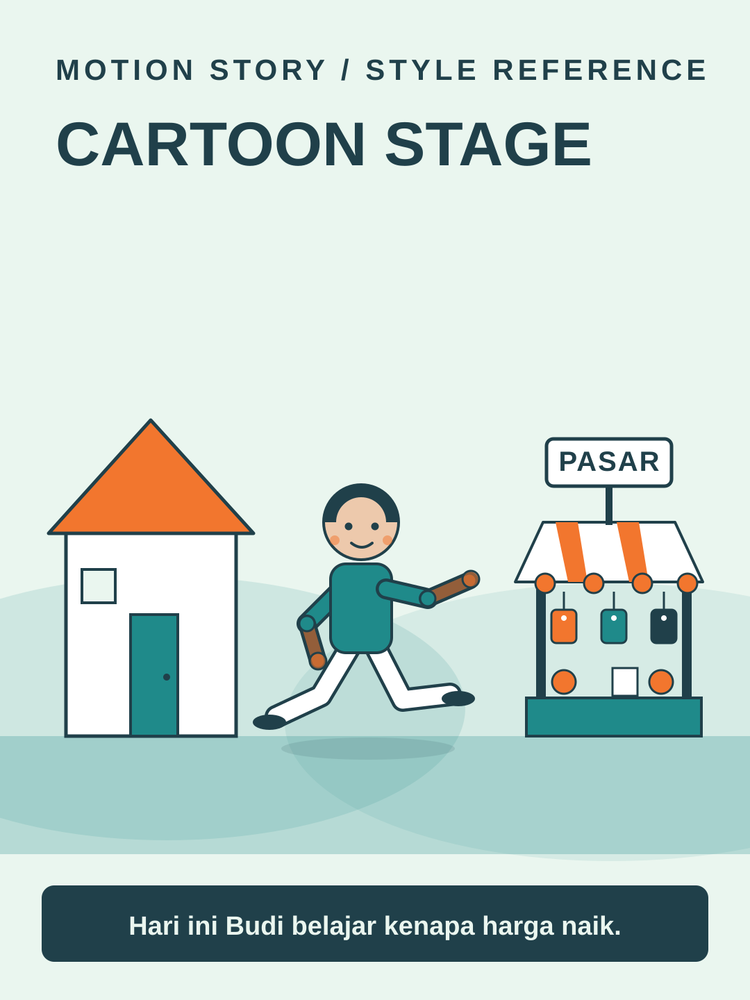</a><br><strong><a href="styles/cartoon-stage/STYLE.md">Cartoon Stage</a></strong><br><sub>Education · kids · stories. One living stage per scene, jointed characters, no captions.</sub><br><br><strong>Hook:</strong> “Hari ini Budi belajar kenapa harga naik.”</td><td width="50%" valign="top"><strong>How to animate these references</strong><br><br>Choose the style name, open the matching style guide, and build continuous motion with an evolving scene. Every new style includes a copy-ready prompt.<br><br><a href="docs/MOTION_GUIDE.md">Motion generation workflow</a></td></tr>
</table>

[**Open all style definitions →**](styles/catalog.json) · [**Open animated style preview →**](styles/preview.html) · [**Read evidence & hook research →**](research/viral-styles-2026.md)

## Default style selection and product photo rule

**No style in the prompt?** Motion Story randomly chooses from the *contextually appropriate* styles in `styles/catalog.json`, records the choice in its working brief, and keeps the choice stable during the production. This is random style assignment, not random animation frames or a guarantee of virality. To force a style, explicitly say `style: manga`, `style: vintage`, or another catalog ID.

**Product Review (or a review using Product X-Ray):** if the actual product image has **not** been supplied in the conversation or an accessible context, the agent **must ask for the product image before creating final motion/video visuals**. It must not invent the product's appearance or silently substitute an unrelated product. If the image is already supplied, do not ask again. The gallery art is illustrative only.

Example no-style prompt:

```text
Buat video edukasi 30 detik tentang cara kerja internet, format 9:16.
Saya tidak menentukan style — pilih secara acak dari gaya yang cocok,
sebutkan style terpilih, lalu bangun HTML motion yang bukan slideshow.
```

Example missing-product-image prompt:

```text
Buat product review 30 detik untuk [NAMA PRODUK].
Pakai style product-review. Jika foto produk belum tersedia,
minta saya unggah foto produknya sebelum generate video final.
```

## Workflow

1. **Select the niche and hook.** Identify one specific question, misconception, surprising fact, problem, or story conflict. Promise only what the video actually delivers.
2. **Choose a style.** Read its `styles/<style-id>/STYLE.md`, inspect its gallery image, and extract **visual grammar**: color, texture, motif, lens, typography and movement.
3. **Ask the AI agent for a motion brief.** Define 9:16 or 16:9, duration, audience, visual beats, evidence sources, voiceover (if any), and the signature movement. Use the image as a **style reference**, not as the only frame of a Ken Burns animation.
4. **Build the motion.** Ask for HTML/CSS/SVG/Canvas with a deterministic timeline: the camera or world transforms continuously, visuals demonstrate the explanation, and the opening is meaningful from frame one.
5. **Review and export.** Scrub opening/middle/end, check mobile safe areas and factual accuracy. Render frames and encode MP4 using suitable browser automation and FFmpeg if needed. Never claim an MP4 exists before actually rendering it.
6. **Measure and iterate.** Compare hooks using retention and engaged views, rather than choosing solely by raw views.

### Make motion from a gallery image

Choose one of the six pictures above and give your agent this instruction:

```text
Read SKILL.md and styles/catalog.json in raydiansyah/motion-story.
Use style: [STYLE_ID] and read styles/[STYLE_ID]/STYLE.md.
Treat assets/styles/[STYLE_ID].svg as a visual keyframe and art direction,
NOT as a static image to zoom or fade.

Create an ORIGINAL 30-second motion graphic about [TOPIK],
for [AUDIENS], in Indonesian, 9:16 (1080x1920).
Make the first second visually compelling with hook [HOOK].
Build a time-based story: hook -> evidence -> explanation -> payoff.
Animate the same visual world with purposeful camera, typography,
object transformations and transitions (not a slideshow).
Use verified evidence; label simplifications.
Deliver a standalone HTML preview, debug timeline, scene/VO script,
and steps to render MP4. Only deliver an MP4 if rendered and tested.
```

For image-to-video generators, use the SVG as a composition reference where supported. Ask for camera movement, object motion, entry and exit actions, preservation of text/visual identity, duration and aspect ratio. Generative video tools may distort typography; for exact text use programmatic motion or compositing.

## Example prompts

Copy a short example into your coding agent and attach the corresponding gallery SVG or link:

**Storyflow — AI explainer**
```text
Create a 30-second 9:16 Indonesian explainer: "Ke mana prompt AI pergi?"
Use Motion Story's storyflow style and its SVG image as art direction.
Start with a glowing question node; the node travels into a network,
reveals a simplified request flow, then returns as a clear answer.
No slideshow. Add a scrub-able deterministic HTML timeline.
```

**Curiosity Lab — science**
```text
Create a 25-second 9:16 science explainer using curiosity-lab.
Hook: "Kenapa dua gelas es ini mencair berbeda?"
Begin with two visible glasses, animate temperature/conditions
and the comparison, then explain the cause with accurate evidence.
Use fluid object motion, not fading slide cards.
```

**Data Shock — statistics**
```text
Create a 20-second 9:16 motion graphic using data-shock:
"1 juta detik vs 1 miliar detik". Start with a striking scale mismatch.
Morph numbers into a visual timeline, display correct units,
verify calculations, and finish with a clear comparison.
```

**Myth Breaker — digital literacy**
```text
Build a 30-second 9:16 myth-breaker explainer:
"Apakah incognito membuat kita anonim?" Open with MITOS vs FAKTA.
Animate a simplified browser/network diagram, show what incognito
does and does not do, cite accurate sources. Keep the conclusion nuanced.
```

**Micro Drama — storytelling**
```text
Make a 35-second 9:16 micro-drama about a verified moment in
computer history. Open in the middle of a consequential decision.
Use a branching choice motif, purposeful character/camera movement,
and show the historical consequence without fabricating facts.
```

**Product X-Ray — gadget / affiliate**
```text
Create a 25-second 9:16 product-xray video about [PRODUCT].
Show a real problem before any sales pitch. Animate a product
exploded view, explain the verified mechanism and real trade-offs,
then close with an honest buying takeaway and affiliate disclosure.
```

**[Full style-specific motion prompts and visual guidance →](docs/MOTION_GUIDE.md)**

### More copy-ready prompts

**Kinetic Burst:** `Buat opener event 15 detik style kinetic-burst; teks besar menghantam bidang warna mengikuti beat, bukan fade slide.`

**Isometric Flow:** `Jelaskan alur data aplikasi dari input ke output 30 detik, style isometric-flow, kamera mengikuti paket data di antara modul.`

**Editorial Cutout:** `Buat explainer sejarah 40 detik style editorial-cutout, foto arsip berlisensi, potongan kertas dan anotasi menjadi satu dunia visual.`

**Blueprint Mechanism:** `Jelaskan cara kerja motor listrik 30 detik menggunakan blueprint-mechanism, perlihatkan komponen terurai dan jalur energi yang benar.`

**Playful Doodle:** `Jelaskan siklus air untuk anak 30 detik style playful-doodle, ilustrasi ramah dengan panah digambar dan karakter yang bereaksi.`


### New style prompt shortcuts

- **Vintage:** `Gunakan style vintage untuk explainer sejarah 30 detik, transisi arsip dan anotasi tinta.`
- **Modern:** `Gunakan style modern untuk opener aplikasi 20 detik, tipografi editorial dan transisi presisi.`
- **Product Review:** `Gunakan style product-review untuk review gadget 30 detik; minta foto produk bila belum ada.`
- **Cartoon:** `Gunakan style cartoon untuk edukasi sains dengan karakter original dan gerakan ekspresif.`
- **Manga:** `Gunakan style manga untuk cerita 30 detik, panel sinematik dan ink reveal orisinal.`
- **Pixel:** `Gunakan style pixel untuk penjelasan teknologi dalam dunia game retro 16-bit.`
- **Roblox-inspired:** `Gunakan style roblox untuk cerita game dunia blocky original, tanpa memakai aset resmi.`
- **Game:** `Gunakan style game untuk explainer strategi dengan HUD dinamis dan demonstrasi mekanik.`

## Getting better results

- **Say which style, not which copied scenes.** Request “Curiosity Lab / experimental split-screen”, not a frame-by-frame recreation of someone else's video.
- **Provide the real assets.** Brand logo, screenshots, permitted photos, product specs, verified data and voiceover improve specificity.
- **Be clear about the one unforgettable moment.** A graph morph, revelation, object close-up or character decision should carry the story.
- **Keep text short.** One compelling visual claim at a time; the visuals do the explaining.
- **Avoid meaningless movement.** More zooms, glows and transitions are not equivalent to higher retention.
- **Test hooks.** The style examples are hypotheses informed by creator guidance, not audited viral rankings.

## Multi-agent setup

Install the same Motion Story reference library for different AI agents. **Global** means across local projects for that agent; **project** means only the selected repository.

| Agent | Global location | Project location |
|---|---|---|
| Claude Code / Claude CLI | `~/.claude/skills/motion-story` | `.claude/skills/motion-story` |
| Codex CLI / IDE | `~/.agents/skills/motion-story` | `.agents/skills/motion-story` |
| Hermes Agent | `~/.hermes/skills/motion-story` | Configure external skill directory |
| ChatGPT | Plugins → Skills → Upload | Managed via ChatGPT UI |
| Custom | Configured skill root | Configured skill root |

**One-command local setup** (after cloning the repository):

```bash
sh scripts/install-agent.sh claude global
sh scripts/install-agent.sh codex global
sh scripts/install-agent.sh hermes global
```

**For ChatGPT:** run `sh scripts/package-skill.sh`, then upload `dist/skill.zip` from **Plugins → Skills → Create → Upload from your computer** where available. No shell installation into ChatGPT's servers occurs automatically.

Example agent prompts: `/motion-story Buat explainer 9:16 dengan style Data Shock` (Claude Code/Hermes), `$motion-story ...` (Codex), or `Gunakan skill Motion Story ...` (ChatGPT).

**[Complete platform-by-platform setup, custom-agent loader, verification and troubleshooting →](docs/AGENT_INSTALL.md)**

## Install & use

### In an AI coding agent

Clone the repo locally, then ask your agent to read its instructions and the chosen style guide:

```bash
git clone https://github.com/raydiansyah/motion-story.git
cd motion-story
```

```text
Read SKILL.md, research/viral-styles-2026.md and
styles/curiosity-lab/STYLE.md. Build my short explainer
following the style guide and the example prompts in README.
```

The repository follows an Agent Skill-friendly layout. To use it across Claude Code, Codex, Cursor or other tools, configure that tool to load `SKILL.md` as project instructions or install/link it according to the agent's supported skill path. Loading conventions differ by agent; cloning alone does not globally enable a skill. Prefer the dedicated [multi-agent installation guide](docs/AGENT_INSTALL.md).

### In the browser

Download or clone this repository and open [`styles/preview.html`](styles/preview.html) in a modern browser. Add `?style=data-shock` to choose a style.

| Control | Action |
|---|---|
| Space | Pause / play |
| R | Restart |
| Slider | Scrub motion timeline |
| `?style=storyflow&clean=1&t=4.2` | Freeze a deterministic reference frame |

The existing browser preview is an **illustrative 12-second demo of the original six styles**; the other twenty-four styles currently have static SVG gallery references and instructions, not an integrated animated preview or MP4 exporter.

## FAQ

**Are these styles guaranteed to go viral?** No. They are creative reference styles; hook, topic, audience, execution, evidence and distribution all affect performance. Measure retention and repeat tests.

**Can I make a 9:16 Shorts/Reels/TikTok video?** Yes. Request that aspect ratio from the agent; the static gallery illustrates the visual direction, while the resulting timeline/video must be built or rendered separately.

**Can I use the gallery picture directly as a full motion video?** Not recommended. An animated zoom on a static picture isn't a real explainer. Transform objects and evidence into successive story beats instead.

**Does this require GSAP?** No. SVG, CSS, Canvas, GSAP or a video renderer can all be used depending on the production; prioritise deterministic timing and a standalone preview.

**Does the repository already export MP4?** Not automatically. Frame capture and video encoding are a separate production step.

**What is the difference from Bang Motion?** Bang Motion inspired the anti-slideshow approach. Motion Story supplies independent visual identities, Indonesian niche/hook references, an original preview and agent guidance for these six concepts.

## Research & license

Research and sources: [Exa + Firecrawl report](research/viral-styles-2026.md).  
Machine-readable styles: [`styles/catalog.json`](styles/catalog.json).  
License: [MIT](LICENSE).
