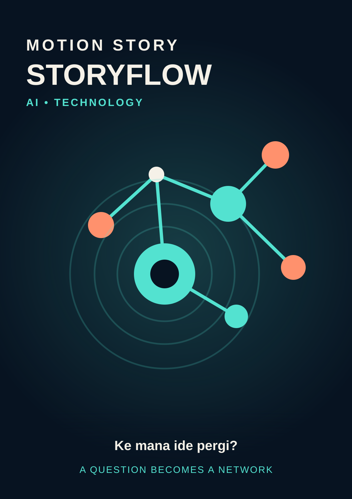
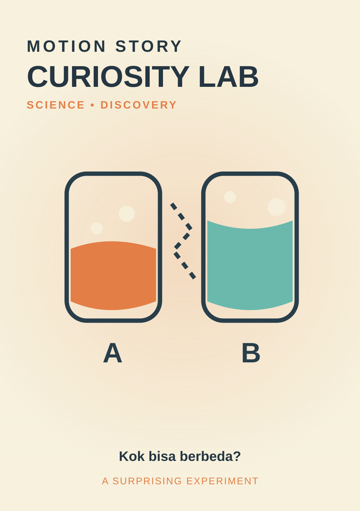
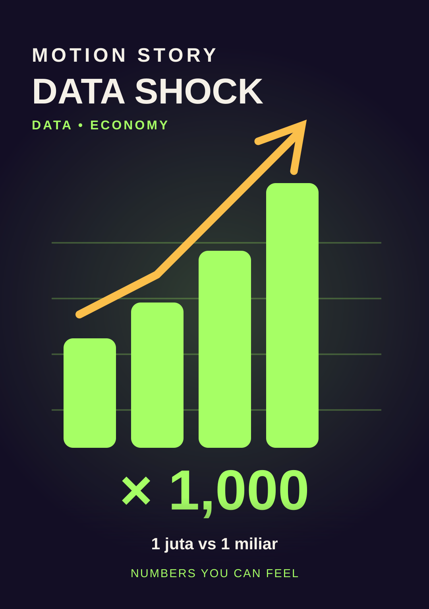
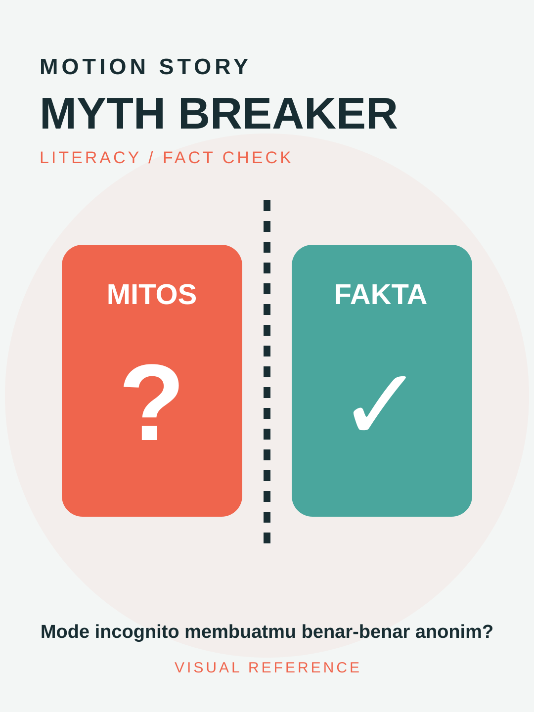
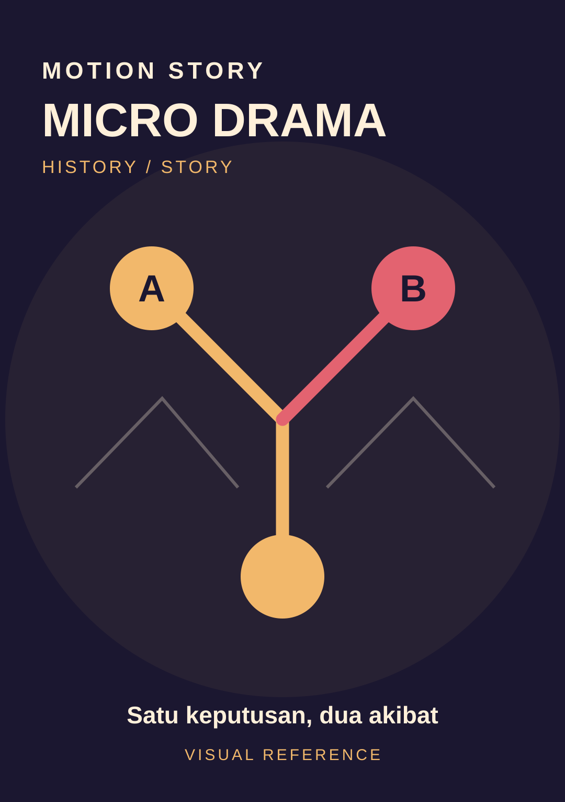
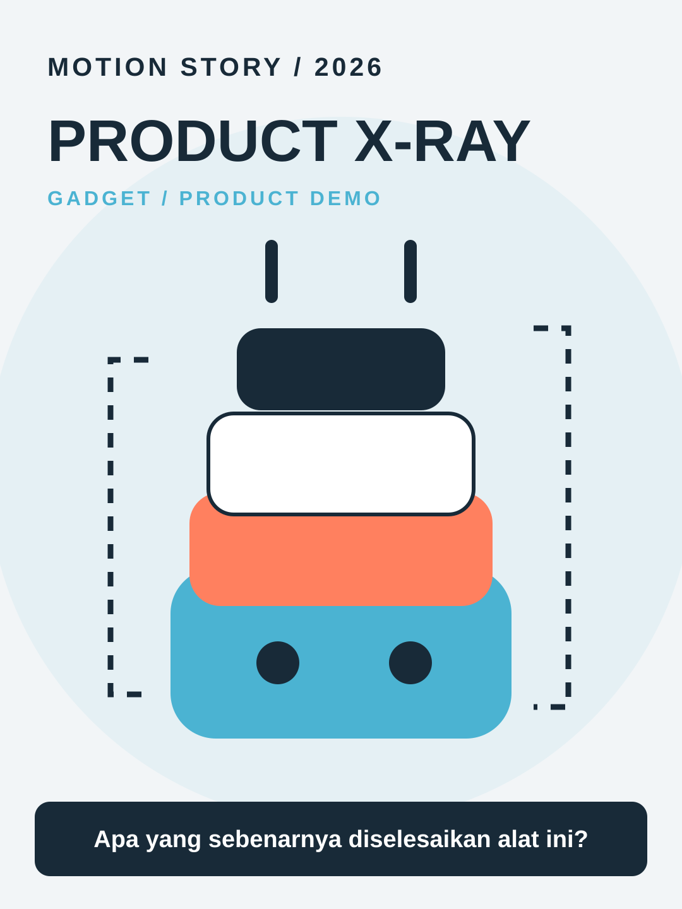

# Motion Generation Guide

This guide explains how to transform each **static style key visual** into a genuinely animated short-form explainer. Each gallery SVG is art direction, **not** a video frame to pan-and-zoom for the full duration.

## Quick command for an AI coding agent

```text
Read SKILL.md, research/viral-styles-2026.md, styles/catalog.json,
and styles/[STYLE_ID]/STYLE.md in this repository.
Use assets/styles/[STYLE_ID].svg as the visual art direction.
Create an original [DURATION]-second, [ASPECT]-ratio motion graphic
in Indonesian about [TOPIC] for [AUDIENCE].
Start with a specific hook in the first second, demonstrate evidence
through moving objects and continuous spatial relationships,
and resolve the opening premise. Build a standalone HTML timeline.
Include pause/restart, ?debug=1 scrubbing, ?clean=1&t=<time> frame capture,
mobile-safe typography, voiceover script, sources, and render instructions.
Do not just animate the single reference SVG as one flat image.
```

## What to supply

| Field | Example |
|---|---|
| STYLE_ID | `data-shock` |
| TOPIC | `Perbandingan 1 juta dan 1 miliar detik` |
| AUDIENCE | `Pelajar SMA Indonesia` |
| DURATION | `25` seconds |
| ASPECT | `9:16` |
| HOOK | `Ternyata beda waktunya sejauh ini!` |
| ASSETS | Verified data, licensed photos, brand logo, product photos |
| AUDIO | No audio, recorded VO, or explicitly licensed soundtrack |

## Six practical motion recipes

### 01 Storyflow — connected explanation



- **Visual continuity:** glowing signal orb travels from question to interconnected explanations.
- **Motion:** pulse starts immediately; orbital nodes connect and become a simplified process diagram; camera approaches one causal link; return to original signal.
- **Hook prompt:** “Ke mana sebenarnya prompt AI pergi?”
- **Agent prompt:**

```text
Use Storyflow to create a 30-second 9:16 Indonesian explainer about
how an AI request is processed, clearly marked as a simplified model.
The first second shows a luminous signal escaping a question.
Build one coherent animated network, show request and response
direction, use smooth camera travel, then answer the initial question.
```

### 02 Curiosity Lab — visual experiment



- **Visual continuity:** two test vessels share a visible measurement reference.
- **Motion:** show outcome first; replay the setup, introduce changed conditions, measure differences, explain the actual cause.
- **Hook prompt:** “Kenapa es di dua gelas ini beda cepat mencair?”
- **Agent prompt:**

```text
Use Curiosity Lab for a 25-second, 9:16 comparison of ice melting
under two clearly labeled conditions. Open with two different results.
Animate the process, measurements and explanatory arrows in the same
scene. Never claim an unperformed experiment was actually recorded.
```

### 03 Data Shock — scale transformation



- **Visual continuity:** one large quantity transforms into a comparison scale.
- **Motion:** start from a striking figure, zoom out to reveal scale, morph counters into bars or a timeline, reveal proper units.
- **Hook prompt:** “Beda 1 juta dan 1 miliar detik ternyata ekstrem!”
- **Agent prompt:**

```text
Use Data Shock in a 20-second 9:16 short contrasting one million
and one billion seconds. Verify the day/year conversions. Create
a continuous number-to-timeline transformation with clear units
and a visual payoff; do not use slide transitions.
```

### 04 Myth Breaker — test and correction



- **Visual continuity:** a split MITOS / FAKTA panel becomes a single evidence diagram.
- **Motion:** reveal a common assumption, simulate a transparent test flow, animate evidence, then display nuance and limitations.
- **Hook prompt:** “Mode incognito benar-benar bikin kamu anonim?”
- **Agent prompt:**

```text
Create a 30-second 9:16 Myth Breaker video about incognito browsing.
Open with an animated myth/fact split, follow a simplified browser
privacy diagram, explain what local browsing history protection does
and does not cover, and cite official documentation.
```

### 05 Micro Drama — consequential choice



- **Visual continuity:** one character/object follows a branching choice.
- **Motion:** open on a decisive moment; reveal the stakes, branch timeline into real alternatives where evidence supports them, show verified consequences.
- **Hook prompt:** “Satu keputusan ini mengubah sejarah komputer.”
- **Agent prompt:**

```text
Use Micro Drama for a 35-second 9:16 historically sourced story.
Begin in medias res with one real decision; stage the tension through
camera, light, subject gestures and branching timeline. Resolve the
historical outcome and distinguish narration from dramatization.
```

### 06 Product X-Ray — mechanism demonstration



- **Visual continuity:** the same product stays in frame while layers physically separate.
- **Motion:** visible user problem, accurate object reveal, exploded component assembly, demo, honest advantages and drawbacks.
- **Hook prompt:** “Apa sebenarnya yang membuat produk ini berguna?”
- **Agent prompt:**

```text
Create a 25-second 9:16 Product X-Ray demo for [PRODUCT].
Start with a specific problem, then separate and label actual product
components based on supplied specs and photos. Show a real function,
avoid unverified performance claims, and disclose affiliation if any.
```

## Recommended time structure (starting hypothesis)

For a 30-second video:

| Time | Purpose |
|---|---|
| 0.0–1.0s | Visually clear question, result, surprise, or conflict |
| 1.0–4.0s | Why the audience should care; early evidence |
| 4.0–12.0s | First explanation with objects transforming |
| 12.0–22.0s | Demonstration or meaningful comparison |
| 22.0–28.0s | Resolve and explain |
| 28.0–30.0s | Brief CTA or memorable loop to opening |

Pacing and duration vary by topic; retention measurements should determine revisions.

## Programmatic motion versus AI video

**Programmatic HTML / Canvas / SVG / GSAP:** best for exact numbers, chart accuracy, branded text, reproducible frames, deterministic seeking, and controllable edits.

**Image-to-video generators:** suitable for atmosphere, character action and illustrative shots. If supported, upload the relevant SVG or a rendered PNG as an image reference and request clear object/camera action. Avoid depending on generated text overlays for exact facts or names.

Example image-to-video prompt:

```text
Animate this key visual as a single cinematic 5-second vertical shot,
maintaining the exact palette, subject identity and composition.
Move the camera forward gently while the primary diagram objects
move and change state in a coherent causal sequence.
No new logos, no invented text, no sudden scene swaps, no slideshow.
9:16 aspect ratio, smooth natural motion, original art direction.
```

## Quality checklist

- Does frame zero already contain a meaningful visual hook?
- Are facts sourced, numbers labeled and comparisons correct?
- Do camera moves reveal new information instead of decorating text?
- Is there a recurring visual subject, with a clear payoff?
- Are type, colors and safe areas readable on a phone?
- Does scrubbing to the same time reproduce the same frame?
- Are third-party visual assets and music appropriately licensed?
- Are affiliate / sponsored relationships disclosed when relevant?
- Is an actual MP4 exported and inspected before claiming delivery?

For strategy and measurement, see [the research ledger](../research/viral-styles-2026.md).
