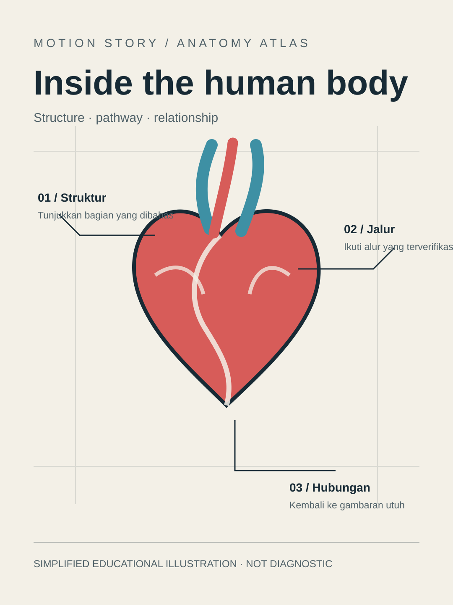

# Anatomy Atlas



**Style ID:** `anatomy-atlas`  
**Purpose:** precise, calm, label-led anatomy and physiology education.  
**Best for:** organ systems, anatomical orientation, body structures, classroom and health-professional learning materials.

## Identity

An editorial science atlas: warm paper, measured grid, fine leader lines, restrained color coding and one highlighted structure at a time. It is intentionally different from the dark, cinematic `medical-science` style.

- Background: `#F3F0E7` (warm atlas paper)
- Primary ink: `#172A35`
- Arterial / active structure: `#D75C59`
- Venous / flow path: `#3E90A4`
- Secondary annotation: `#D6A64B`
- Text: `#172A35`, with muted supporting labels `#52636A`
- Motif: one anatomical cutaway with numbered callouts and a traceable flow path.
- Type: precise sans-serif labels; no decorative display type inside diagrams.

## Motion grammar

1. Establish body orientation with a neutral silhouette or body-region locator.
2. Isolate one organ or structure using a mask, highlight or gentle cutaway.
3. Reveal only the relevant layers; separate layers along a clear axis.
4. Trace one pathway (air, blood, food, nerve signal or another verified process).
5. Return to the whole structure and recap the relationship.

Use slow camera travel, restrained line drawing, measured layer separation and callout tracking. Avoid dramatic zooms, exaggerated pulsing, gore and unnecessary 3D gloss.

## Story arc

**Orientation → structure → pathway → relationship → recap.**

Every label must point to the correct object. Keep one primary structure highlighted at a time. Use a legend when color coding is necessary and never rely on color alone.

## Accuracy and safety

- Use reputable anatomy references and topic-specific medical sources; list source title, publisher, URL and access date in the brief.
- Treat the bundled `assets/anatomy/*.svg` files as original simplified visual primitives, not anatomical authorities or diagnostic diagrams.
- Never imply that these SVGs are to scale, clinically validated, or suitable for procedural guidance.
- Verify every anatomical term, direction, connection and pathway with an appropriate source.
- Distinguish normal anatomy from pathology. Do not add disease lesions or symptoms unless the topic and evidence support them.
- For clinical training, invasive procedures, diagnosis or treatment content, require qualified professional review.
- Use an on-screen note such as **“Ilustrasi edukasi sederhana — bukan gambar diagnostik.”**

## Production contract

- 9:16 portrait first; 1080×1920 composition.
- Deterministic timeline: every frame is a pure function of time.
- Build anatomy from separate layers / SVG groups; do not animate a flattened poster.
- Use a stable label layer outside camera transforms.
- Provide pause, restart, timeline scrub and fixed-time frame capture.
- Check label collision, line routing, mobile safe areas and contrast at opening, middle and end.
- No MP4 claim without a verified render.

## Example topic

**Topic:** Bagaimana darah mengalir melalui jantung?

Use a simplified heart asset as the hero, then trace a clearly sourced flow path. Do not infer that the illustration represents a real patient's heart or a clinical scan.

## Copy-ready prompt

```text
Read styles/anatomy-atlas/STYLE.md and use style: anatomy-atlas.
Create a 30-second Indonesian 9:16 educational explainer about [TOPIC].
Use warm atlas paper, precise labels, fine leader lines and restrained
arterial/venous colors. Start with body orientation, isolate the relevant
structure, reveal the layers needed to explain the mechanism, trace one
verified pathway, then return to the whole structure.

Use assets/anatomy as simplified reusable visual primitives only.
Verify anatomical names and pathways against reputable sources.
Do not invent structures, pathology or clinical advice. Label the work
as a simplified educational illustration, not a diagnostic image.
Deliver a deterministic HTML preview, source list, beat sheet,
voiceover and exact render instructions.
```
