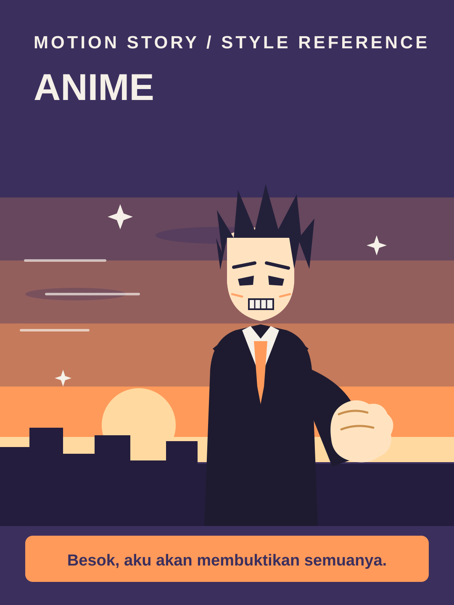

# Anime



**Style ID:** `anime`  
**Status:** visual keyframe and motion design reference (not a finished MP4)  
**Best niches:** youth, drama, fandom  
**Hook mechanism:** cliffhanger-vow

## Art direction

**Palette:** #3B2F5E, #FF9A5A, #FFD9A0, #F5F0E8.  
**Recurring visual motif:** cel-shaded-sunset-scene.  
**Motion signature:** cel-shaded characters hold dramatic poses; speed lines and slow sunset pans raise the stakes.

Use the [gallery illustration](../../assets/styles/anime.svg) as a visual style reference, **not** one flat picture to zoom and fade. Rebuild its component shapes in an original time-based scene using SVG, Canvas, CSS or GSAP with an explicit deterministic timeline.

## Storyboard beats

1. **vow** — animate evidence and subjects, connecting this beat to the previous one.
2. **rival** — animate evidence and subjects, connecting this beat to the previous one.
3. **clash** — animate evidence and subjects, connecting this beat to the previous one.
4. **cliffhanger** — animate evidence and subjects, connecting this beat to the previous one.

## Simple Indonesian hook

> Besok, aku akan membuktikan semuanya.

## Copy-ready agent prompt

```text
Gunakan skill motion-story dengan style Anime (anime).
Buat video motion graphic 30 detik format 9:16 (1080x1920)
tentang [TOPIK] untuk penonton Indonesia.
Gunakan assets/styles/anime.svg sebagai referensi komposisi,
warna, dan identitas visual, bukan sebagai slide statis.
Hook: "Besok, aku akan membuktikan semuanya."
Gerak utama: cel-shaded characters hold dramatic poses; speed lines and slow sunset pans raise the stakes.
Bangun satu dunia visual yang berkembang secara kontinu;
perlihatkan objek, hubungan, atau bukti baru seiring narasi.
Buat HTML standalone dengan timeline deterministik, pause,
restart, scrub debug dan ?clean=1&t=4.2 untuk render frame.
Sertakan naskah VO dan petunjuk render MP4.
```

## Quality constraints

- Hook must be understandable within the first second.
- Avoid generic title/body/card slideshow transitions and static image-only parallax.
- Maintain readable typography at mobile size and safe areas for UI overlays.
- Keep every character original; never copy a copyrighted anime character, hairstyle or uniform exactly.
- Retention improvement is a hypothesis; test against actual channel analytics.

[All styles](../../README.md#style-gallery) · [Motion generation guide](../../docs/MOTION_GUIDE.md)
