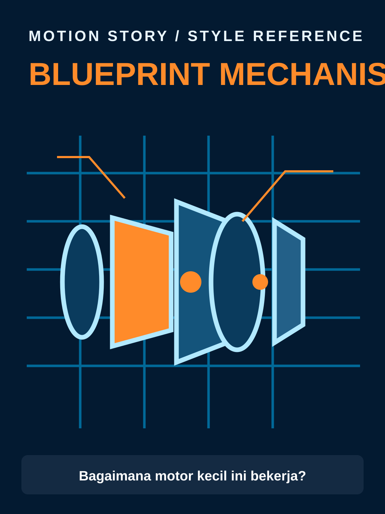

# Blueprint Mechanism



**Style ID:** `blueprint-mechanism`  
**Status:** visual keyframe and motion design reference (not a finished MP4)  
**Best niches:** engineering, machines, tech gadgets  
**Hook mechanism:** hidden-mechanism

## Art direction

**Palette:** #031A31, #00B7FF, #FF8B2A, #DDEFFF.  
**Recurring visual motif:** exploded-technical-assembly.  
**Motion signature:** parts separate along measured axes and reassemble.

Use the [gallery illustration](../../assets/styles/blueprint-mechanism.svg) as a visual style reference, **not** one flat picture to zoom and fade. Rebuild its component shapes in an original time-based scene using SVG, Canvas, CSS or GSAP with an explicit deterministic timeline.

## Storyboard beats

1. **outer-shell** — animate evidence and subjects, connecting this beat to the previous one.
2. **exploded-parts** — animate evidence and subjects, connecting this beat to the previous one.
3. **energy-flow** — animate evidence and subjects, connecting this beat to the previous one.
4. **reassembled-mechanism** — animate evidence and subjects, connecting this beat to the previous one.

## Simple Indonesian hook

> Bagaimana motor kecil ini bekerja?

## Copy-ready agent prompt

```text
Gunakan skill motion-story dengan style Blueprint Mechanism (blueprint-mechanism).
Buat video motion graphic 30 detik format 9:16 (1080x1920)
tentang [TOPIK] untuk penonton Indonesia.
Gunakan assets/styles/blueprint-mechanism.svg sebagai referensi komposisi,
warna, dan identitas visual, bukan sebagai slide statis.
Hook: "Bagaimana motor kecil ini bekerja?"
Gerak utama: parts separate along measured axes and reassemble.
Bangun satu dunia visual yang berkembang secara kontinu;
perlihatkan objek, hubungan, atau bukti baru seiring narasi.
Buat HTML standalone dengan timeline deterministik, pause,
restart, scrub debug dan ?clean=1&t=4.2 untuk render frame.
Sertakan naskah VO dan petunjuk render MP4.
```

## Quality constraints

- Hook must be understandable within the first second.
- Avoid generic title/body/card slideshow transitions and static image-only parallax.
- Maintain readable typography at mobile size and safe areas for UI overlays.
- Verify dimensions and component names; label conceptual diagrams.
- Retention improvement is a hypothesis; test against actual channel analytics.

[All styles](../../README.md#style-gallery) · [Motion generation guide](../../docs/MOTION_GUIDE.md)
