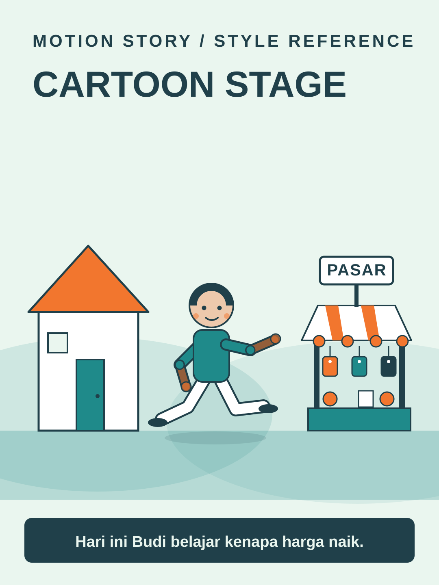

# Cartoon Stage



**Style ID:** `cartoon-stage`  
**Status:** visual keyframe and motion design reference (not a finished MP4)  
**Best niches:** education, kids, stories  
**Hook mechanism:** character-journey

## Art direction

**Palette:** #EAF6EF, #F2762E, #1F8A8A, #20404A.  
**Recurring visual motif:** living-stage-character.  
**Motion signature:** jointed characters act on one living stage; the world reacts around them, no captions needed.

Use the [gallery illustration](../../assets/styles/cartoon-stage.svg) as a visual style reference, **not** one flat picture to zoom and fade. Rebuild its component shapes in an original time-based scene using SVG, Canvas, CSS or GSAP with an explicit deterministic timeline.

## Storyboard beats

1. **stage** — animate evidence and subjects, connecting this beat to the previous one.
2. **journey** — animate evidence and subjects, connecting this beat to the previous one.
3. **encounter** — animate evidence and subjects, connecting this beat to the previous one.
4. **lesson** — animate evidence and subjects, connecting this beat to the previous one.

## Simple Indonesian hook

> Hari ini Budi belajar kenapa harga naik.

## Copy-ready agent prompt

```text
Gunakan skill motion-story dengan style Cartoon Stage (cartoon-stage).
Buat video motion graphic 30 detik format 9:16 (1080x1920)
tentang [TOPIK] untuk penonton Indonesia.
Gunakan assets/styles/cartoon-stage.svg sebagai referensi komposisi,
warna, dan identitas visual, bukan sebagai slide statis.
Hook: "Hari ini Budi belajar kenapa harga naik."
Gerak utama: jointed characters act on one living stage; the world reacts around them, no captions needed.
Bangun satu dunia visual yang berkembang secara kontinu;
perlihatkan objek, hubungan, atau bukti baru seiring narasi.
Buat HTML standalone dengan timeline deterministik, pause,
restart, scrub debug dan ?clean=1&t=4.2 untuk render frame.
Sertakan naskah VO dan petunjuk render MP4.
```

## Quality constraints

- Hook must be understandable within the first second.
- Avoid generic title/body/card slideshow transitions and static image-only parallax.
- Maintain readable typography at mobile size and safe areas for UI overlays.
- Acting must carry the story without captions; keep character joints clean at mobile size.
- Retention improvement is a hypothesis; test against actual channel analytics.

[All styles](../../README.md#style-gallery) · [Motion generation guide](../../docs/MOTION_GUIDE.md)
