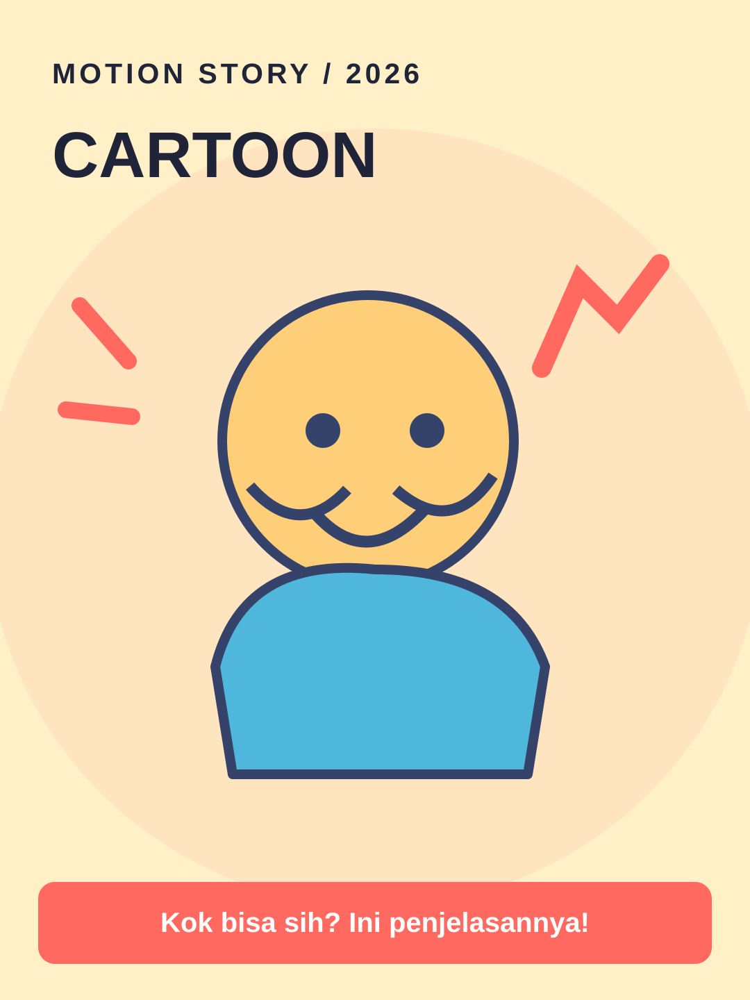

# Cartoon



**Style ID:** `cartoon` · **Status:** static visual keyframe and agent motion instructions  
**Niches:** education, comedy, family  
**Hook structure:** character-reaction

## Visual design system

- Palette: #FFF0C8, #FF695F, #50B7DC, #35436B
- Main visual motif: **expressive-original-2d-character**
- Signature motion: squash stretch, gesture arcs and staged acting
- Use image as art direction and recreate separate animated elements; do not simply zoom a flat reference.

## Scene/beat logic
1. **reaction** — move the world or subject in a causally meaningful way.
2. **problem** — move the world or subject in a causally meaningful way.
3. **explanation** — move the world or subject in a causally meaningful way.
4. **payoff** — move the world or subject in a causally meaningful way.

## Example hook
> Kok bisa sih? Ini penjelasannya!

## Simple agent prompt

```text
Gunakan skill motion-story dengan style Cartoon (cartoon).
Buat motion graphic berbahasa Indonesia, durasi 30 detik, rasio 9:16.
Topik: [TOPIK]. Audiens: [AUDIENS].
Gunakan assets/styles/cartoon.svg sebagai referensi gaya visual
dan gerakan: squash stretch, gesture arcs and staged acting.
Hook awal: "Kok bisa sih? Ini penjelasannya!"
Bangun adegan kontinu berbasis bukti, bukan slideshow.
Output: HTML standalone, timeline deterministik, debug scrub, VO script,
dan langkah export MP4. Klaim render MP4 hanya bila benar-benar dilakukan.
```

## Quality / factual safeguards

Original characters and consistent designs.

Use mobile-safe sizes, original art, deterministic time sampling, and a coherent visual world. The style is a creative reference, not a prediction of virality.

[All styles](../../README.md#style-gallery) · [Motion guide](../../docs/MOTION_GUIDE.md)
