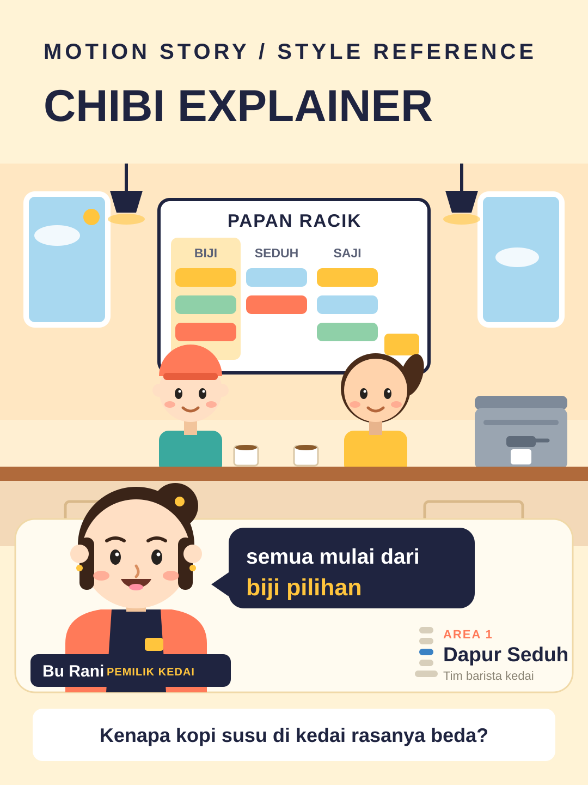

# Chibi Explainer



**Style ID:** `chibi-explainer`  
**Status:** visual keyframe and motion design reference (not a finished MP4)  
**Best niches:** business, education, process-explainers  
**Hook mechanism:** presenter-address

## Art direction

**Palette:** #FFF3D6, #1F2440, #FFC53D, #FF7A59.  
**Recurring visual motif:** chibi-presenter-layered-scene.  
**Motion signature:** presenter pops in with a speech bubble; board cards slide in one by one; background characters bob and work at their stations; slow camera push between annotated areas.

The scene is built in four layers, back to front: (1) a pastel environment band (room, windows, lamps), (2) a work board on the wall carrying the evidence — columns of process cards that fill in as the narration advances, (3) midground chibi workers acting out the process at their stations, and (4) a foreground presenter card: one big chibi host (head about half the visible body height) speaks directly to camera through a dark-navy speech bubble, anchored by a name plate and an annotation chip that labels the current AREA and team. Flat shapes, minimal shading, blush cheeks, one dark navy anchor color against the pastel world.

Use the [gallery illustration](../../assets/styles/chibi-explainer.svg) as a visual style reference, **not** one flat picture to zoom and fade. Rebuild its component shapes in an original time-based scene using SVG, Canvas, CSS or GSAP with an explicit deterministic timeline.

## Storyboard beats

1. **presenter-hook** — animate evidence and subjects, connecting this beat to the previous one.
2. **scene-tour** — animate evidence and subjects, connecting this beat to the previous one.
3. **board-proof** — animate evidence and subjects, connecting this beat to the previous one.
4. **takeaway** — animate evidence and subjects, connecting this beat to the previous one.

## Simple Indonesian hook

> Kenapa kopi susu di kedai rasanya beda?

## Copy-ready agent prompt

```text
Gunakan skill motion-story dengan style Chibi Explainer (chibi-explainer).
Buat video motion graphic 30 detik format 9:16 (1080x1920)
tentang [TOPIK] untuk penonton Indonesia.
Gunakan assets/styles/chibi-explainer.svg sebagai referensi komposisi,
warna, dan identitas visual, bukan sebagai slide statis.
Hook: "Kenapa kopi susu di kedai rasanya beda?"
Gerak utama: presenter pops in with a speech bubble; board cards slide in one by one; background characters bob and work at their stations; slow camera push between annotated areas.
Bangun satu dunia visual yang berkembang secara kontinu;
perlihatkan objek, hubungan, atau bukti baru seiring narasi.
Buat HTML standalone dengan timeline deterministik, pause,
restart, scrub debug dan ?clean=1&t=4.2 untuk render frame.
Sertakan naskah VO dan petunjuk render MP4.
```

## Quality constraints

- Hook must be understandable within the first second.
- Avoid generic title/body/card slideshow transitions and static image-only parallax.
- Maintain readable typography at mobile size and safe areas for UI overlays.
- Annotation chips must label real areas and steps; board cards and presenter claims stay factual — no invented metrics.
- Presenter expressions must match the narration beat; keep the presenter card inside the bottom safe area on every platform.
- Retention improvement is a hypothesis; test against actual channel analytics.

[All styles](../../README.md#style-gallery) · [Motion generation guide](../../docs/MOTION_GUIDE.md)
