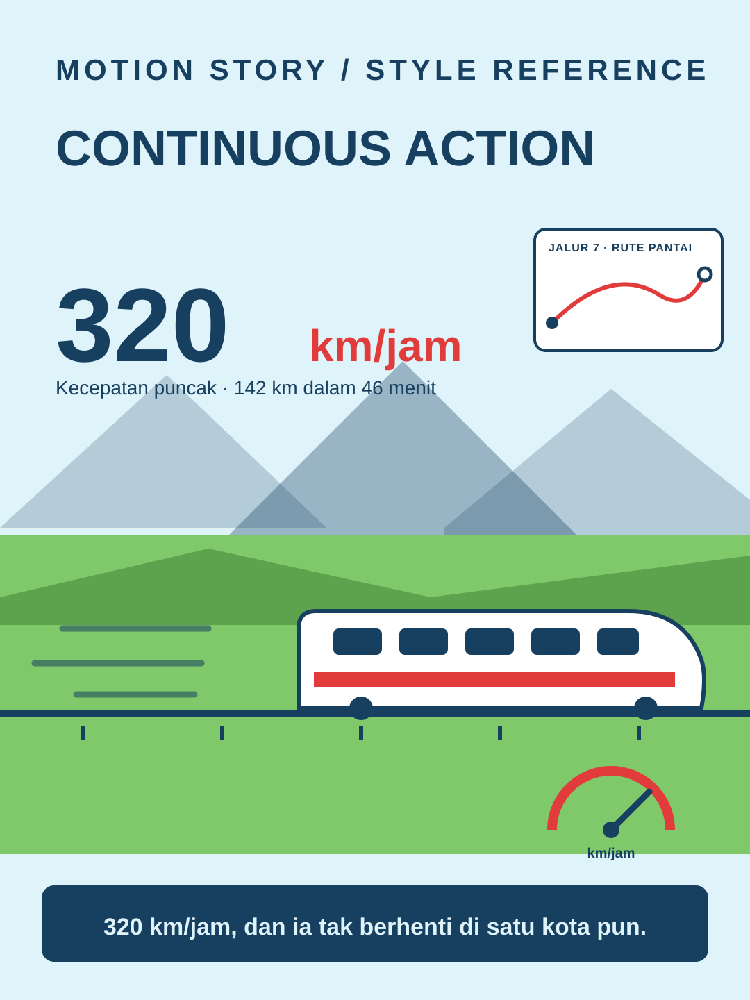

# Continuous Action



**Style ID:** `continuous-action`  
**Status:** visual keyframe and motion design reference (not a finished MP4)  
**Best niches:** transport, logistics, processes  
**Hook mechanism:** living-number

## Art direction

**Palette:** #DFF3FA, #E23B3B, #7FC96B, #173F5F.  
**Recurring visual motif:** never-stopping-subject.  
**Motion signature:** one subject never stops; numbers, maps and gauges live inside the moving world.

Use the [gallery illustration](../../assets/styles/continuous-action.svg) as a visual style reference, **not** one flat picture to zoom and fade. Rebuild its component shapes in an original time-based scene using SVG, Canvas, CSS or GSAP with an explicit deterministic timeline.

## Storyboard beats

1. **launch** — animate evidence and subjects, connecting this beat to the previous one.
2. **speed** — animate evidence and subjects, connecting this beat to the previous one.
3. **route** — animate evidence and subjects, connecting this beat to the previous one.
4. **arrival** — animate evidence and subjects, connecting this beat to the previous one.

## Simple Indonesian hook

> 320 km/jam, dan ia tak berhenti di satu kota pun.

## Copy-ready agent prompt

```text
Gunakan skill motion-story dengan style Continuous Action (continuous-action).
Buat video motion graphic 30 detik format 9:16 (1080x1920)
tentang [TOPIK] untuk penonton Indonesia.
Gunakan assets/styles/continuous-action.svg sebagai referensi komposisi,
warna, dan identitas visual, bukan sebagai slide statis.
Hook: "320 km/jam, dan ia tak berhenti di satu kota pun."
Gerak utama: one subject never stops; numbers, maps and gauges live inside the moving world.
Bangun satu dunia visual yang berkembang secara kontinu;
perlihatkan objek, hubungan, atau bukti baru seiring narasi.
Buat HTML standalone dengan timeline deterministik, pause,
restart, scrub debug dan ?clean=1&t=4.2 untuk render frame.
Sertakan naskah VO dan petunjuk render MP4.
```

## Quality constraints

- Hook must be understandable within the first second.
- Avoid generic title/body/card slideshow transitions and static image-only parallax.
- Maintain readable typography at mobile size and safe areas for UI overlays.
- Speed, distance and time figures must be accurate for the subject shown.
- Retention improvement is a hypothesis; test against actual channel analytics.

[All styles](../../README.md#style-gallery) · [Motion generation guide](../../docs/MOTION_GUIDE.md)
