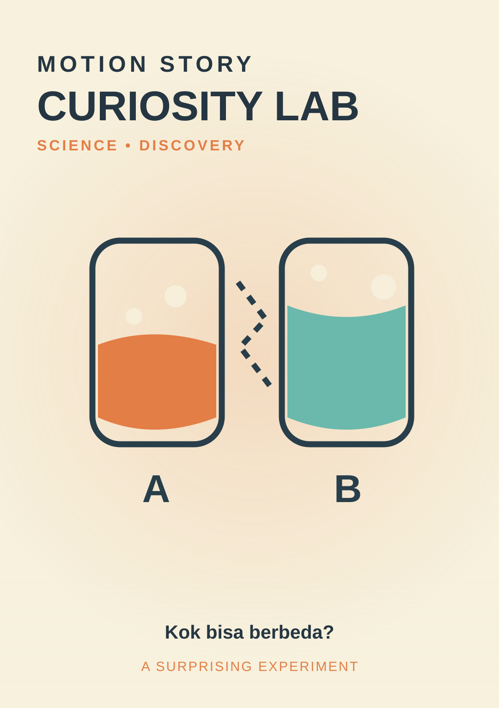

# Curiosity Lab

**Style ID:** `curiosity-lab`  
**Status:** reference concept; prototype with the shared demo engine  
**Niches:** science, facts, experiments  
**Hook:** show-result-first

## Original visual system
Palette: background `#F7F1DD` · primary `#283E4A` · accent `#E37E46` · secondary `#6AB9AC` · type `#283E4A`.

Recurring motif: **two-experiment-vessels**. Motion grammar: split-screen test, liquid-like reveal, annotated evidence. Each beat must alter the underlying evidence rather than just fading to a new text card.

## Video beats
1. **visual-surprise** — serve a concrete narrative function through objects and motion.
2. **hypothesis** — serve a concrete narrative function through objects and motion.
3. **experiment** — serve a concrete narrative function through objects and motion.
4. **explanation** — serve a concrete narrative function through objects and motion.

## Example Indonesian hook
> Kenapa dua gelas ini mencair dengan kecepatan berbeda?

## Production notes
- Format 9:16 vertical first (1080 × 1920), with adaptable horizontal 16:9 staging.
- Reveal the central visual premise within the first second; test hooks rather than asserting any viral guarantee.
- Prefer one evolving visual world, no generic three-card presentations, no meaningless transitions.
- Preserve readability, safe areas, deterministic frame rendering, and genuine evidence.
- **Credibility guardrail:** Do not stage demonstrations as authentic experiments or omit critical controls.
- Compare variants with the metrics in [research](../../research/viral-styles-2026.md); do not equate views with viewer satisfaction.

[Open reference preview](../preview.html?style=curiosity-lab) (open locally or through GitHub Pages after deployment).
