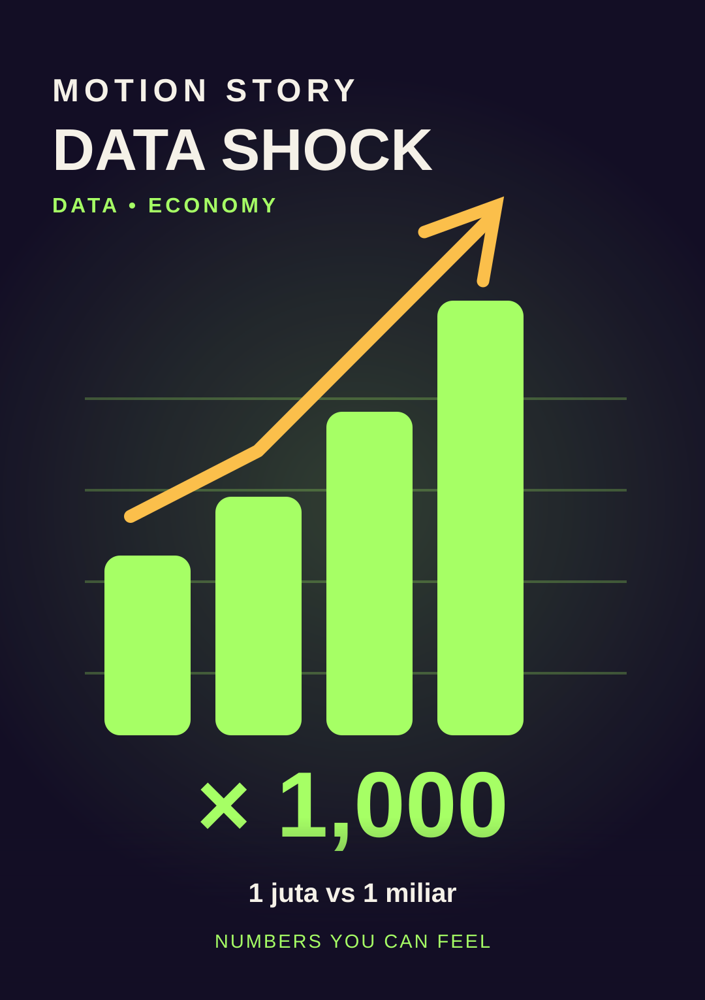

# Data Shock

**Style ID:** `data-shock`  
**Status:** reference concept; prototype with the shared demo engine  
**Niches:** statistics, economics, technology  
**Hook:** counterintuitive-scale

## Original visual system
Palette: background `#130E25` · primary `#A6FF65` · accent `#FBBF4B` · type `#F6F3FA`.

Recurring motif: **large-number-as-physical-scale**. Motion grammar: numeric morph, scale zoom, cause-linked comparison. Each beat must alter the underlying evidence rather than just fading to a new text card.

## Video beats
1. **number** — serve a concrete narrative function through objects and motion.
2. **comparison** — serve a concrete narrative function through objects and motion.
3. **scale-reveal** — serve a concrete narrative function through objects and motion.
4. **meaning** — serve a concrete narrative function through objects and motion.

## Example Indonesian hook
> Seberapa lama satu juta detik dibanding satu miliar?

## Production notes
- Format 9:16 vertical first (1080 × 1920), with adaptable horizontal 16:9 staging.
- Reveal the central visual premise within the first second; test hooks rather than asserting any viral guarantee.
- Prefer one evolving visual world, no generic three-card presentations, no meaningless transitions.
- Preserve readability, safe areas, deterministic frame rendering, and genuine evidence.
- **Credibility guardrail:** Every number needs verified units and source attribution.
- Compare variants with the metrics in [research](../../research/viral-styles-2026.md); do not equate views with viewer satisfaction.

[Open reference preview](../preview.html?style=data-shock) (open locally or through GitHub Pages after deployment).
