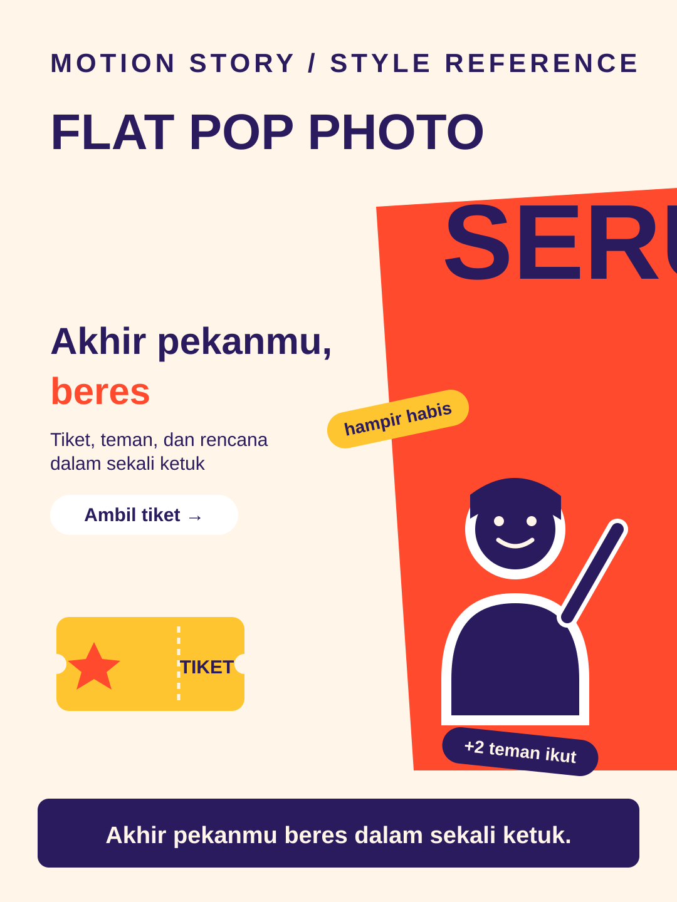

# Flat Pop Photo



**Style ID:** `flat-pop-photo`  
**Status:** visual keyframe and motion design reference (not a finished MP4)  
**Best niches:** consumer apps, campaigns, e-commerce  
**Hook mechanism:** social-proof-pop

## Art direction

**Palette:** #FFF6E9, #FF4A2D, #FFC531, #2A1A5E.  
**Recurring visual motif:** photo-cutout-stickers.  
**Motion signature:** photo cutouts pop in with stickers; brand color fields snap when a visible trigger fires.

Use the [gallery illustration](../../assets/styles/flat-pop-photo.svg) as a visual style reference, **not** one flat picture to zoom and fade. Rebuild its component shapes in an original time-based scene using SVG, Canvas, CSS or GSAP with an explicit deterministic timeline.

## Storyboard beats

1. **scroll-stop** — animate evidence and subjects, connecting this beat to the previous one.
2. **pop** — animate evidence and subjects, connecting this beat to the previous one.
3. **friends** — animate evidence and subjects, connecting this beat to the previous one.
4. **booked** — animate evidence and subjects, connecting this beat to the previous one.

## Simple Indonesian hook

> Akhir pekanmu beres dalam sekali ketuk.

## Copy-ready agent prompt

```text
Gunakan skill motion-story dengan style Flat Pop Photo (flat-pop-photo).
Buat video motion graphic 30 detik format 9:16 (1080x1920)
tentang [TOPIK] untuk penonton Indonesia.
Gunakan assets/styles/flat-pop-photo.svg sebagai referensi komposisi,
warna, dan identitas visual, bukan sebagai slide statis.
Hook: "Akhir pekanmu beres dalam sekali ketuk."
Gerak utama: photo cutouts pop in with stickers; brand color fields snap when a visible trigger fires.
Bangun satu dunia visual yang berkembang secara kontinu;
perlihatkan objek, hubungan, atau bukti baru seiring narasi.
Buat HTML standalone dengan timeline deterministik, pause,
restart, scrub debug dan ?clean=1&t=4.2 untuk render frame.
Sertakan naskah VO dan petunjuk render MP4.
```

## Quality constraints

- Hook must be understandable within the first second.
- Avoid generic title/body/card slideshow transitions and static image-only parallax.
- Maintain readable typography at mobile size and safe areas for UI overlays.
- Photo cutouts need licensed images or generated fictional people; real people need releases.
- Retention improvement is a hypothesis; test against actual channel analytics.

[All styles](../../README.md#style-gallery) · [Motion generation guide](../../docs/MOTION_GUIDE.md)
