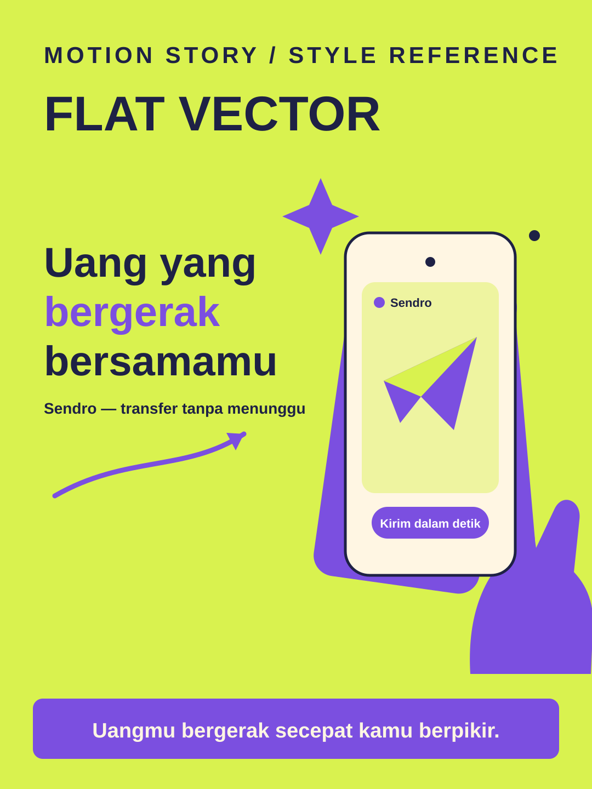

# Flat Vector



**Style ID:** `flat-vector`  
**Status:** visual keyframe and motion design reference (not a finished MP4)  
**Best niches:** fintech, consumer apps, e-commerce  
**Hook mechanism:** benefit-promise

## Art direction

**Palette:** #D9F24F, #7B4FE0, #FFF6E3, #1E2145.  
**Recurring visual motif:** flat-phone-paper-plane.  
**Motion signature:** flat shapes pop with gentle overshoot; UI is drawn in the same flat language.

Use the [gallery illustration](../../assets/styles/flat-vector.svg) as a visual style reference, **not** one flat picture to zoom and fade. Rebuild its component shapes in an original time-based scene using SVG, Canvas, CSS or GSAP with an explicit deterministic timeline.

## Storyboard beats

1. **need** — animate evidence and subjects, connecting this beat to the previous one.
2. **tap** — animate evidence and subjects, connecting this beat to the previous one.
3. **send** — animate evidence and subjects, connecting this beat to the previous one.
4. **arrive** — animate evidence and subjects, connecting this beat to the previous one.

## Simple Indonesian hook

> Uangmu bergerak secepat kamu berpikir.

## Copy-ready agent prompt

```text
Gunakan skill motion-story dengan style Flat Vector (flat-vector).
Buat video motion graphic 30 detik format 9:16 (1080x1920)
tentang [TOPIK] untuk penonton Indonesia.
Gunakan assets/styles/flat-vector.svg sebagai referensi komposisi,
warna, dan identitas visual, bukan sebagai slide statis.
Hook: "Uangmu bergerak secepat kamu berpikir."
Gerak utama: flat shapes pop with gentle overshoot; UI is drawn in the same flat language.
Bangun satu dunia visual yang berkembang secara kontinu;
perlihatkan objek, hubungan, atau bukti baru seiring narasi.
Buat HTML standalone dengan timeline deterministik, pause,
restart, scrub debug dan ?clean=1&t=4.2 untuk render frame.
Sertakan naskah VO dan petunjuk render MP4.
```

## Quality constraints

- Hook must be understandable within the first second.
- Avoid generic title/body/card slideshow transitions and static image-only parallax.
- Maintain readable typography at mobile size and safe areas for UI overlays.
- Financial speed or savings claims need a real basis in the product.
- Retention improvement is a hypothesis; test against actual channel analytics.

[All styles](../../README.md#style-gallery) · [Motion generation guide](../../docs/MOTION_GUIDE.md)
