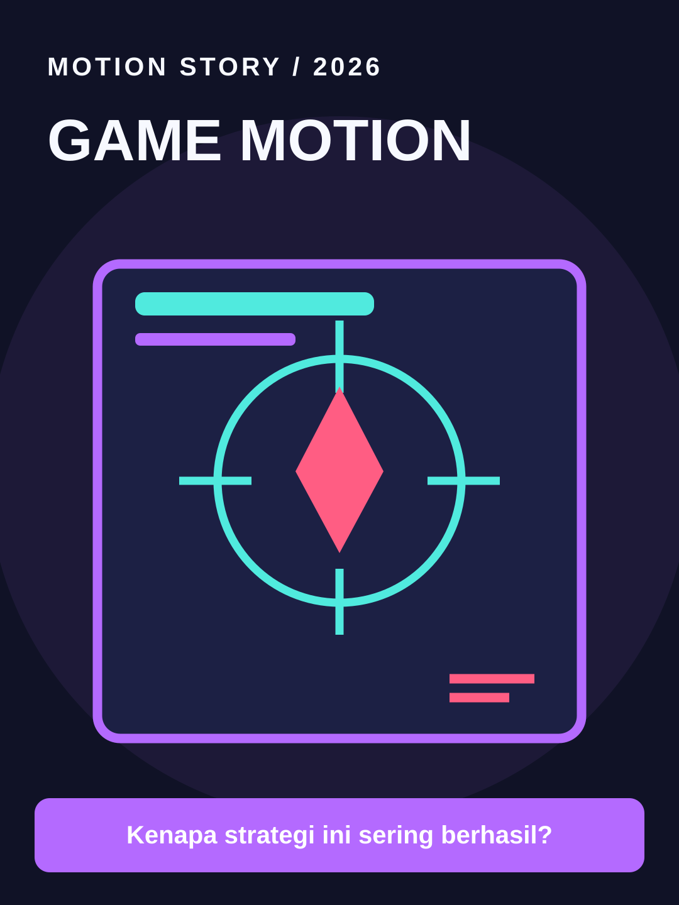

# Game Motion



**Style ID:** `game` · **Status:** static visual keyframe and agent motion instructions  
**Niches:** gaming, esports, mechanics  
**Hook structure:** gameplay-result-first

## Visual design system

- Palette: #101226, #B46AFF, #50EADE, #FF5D83
- Main visual motif: **game-hud-world**
- Signature motion: HUD tracing, impact feedback, simulated gameplay camera
- Use image as art direction and recreate separate animated elements; do not simply zoom a flat reference.

## Scene/beat logic
1. **result** — move the world or subject in a causally meaningful way.
2. **challenge** — move the world or subject in a causally meaningful way.
3. **mechanics** — move the world or subject in a causally meaningful way.
4. **lesson** — move the world or subject in a causally meaningful way.

## Example hook
> Kenapa strategi ini sering berhasil?

## Simple agent prompt

```text
Gunakan skill motion-story dengan style Game Motion (game).
Buat motion graphic berbahasa Indonesia, durasi 30 detik, rasio 9:16.
Topik: [TOPIK]. Audiens: [AUDIENS].
Gunakan assets/styles/game.svg sebagai referensi gaya visual
dan gerakan: HUD tracing, impact feedback, simulated gameplay camera.
Hook awal: "Kenapa strategi ini sering berhasil?"
Bangun adegan kontinu berbasis bukti, bukan slideshow.
Output: HTML standalone, timeline deterministik, debug scrub, VO script,
dan langkah export MP4. Klaim render MP4 hanya bila benar-benar dilakukan.
```

## Quality / factual safeguards

Label simulated gameplay and use authorized footage only.

Use mobile-safe sizes, original art, deterministic time sampling, and a coherent visual world. The style is a creative reference, not a prediction of virality.

[All styles](../../README.md#style-gallery) · [Motion guide](../../docs/MOTION_GUIDE.md)
