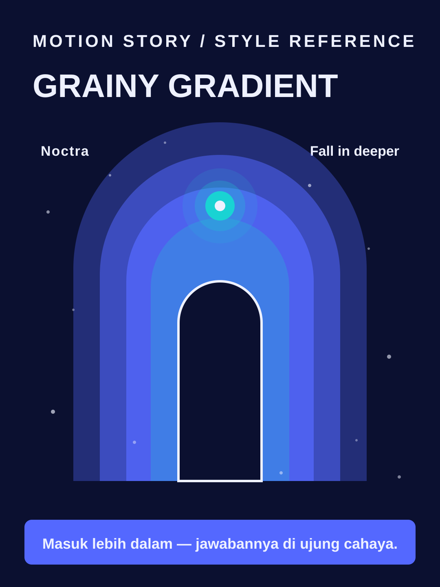

# Grainy Gradient



**Style ID:** `grainy-gradient`  
**Status:** visual keyframe and motion design reference (not a finished MP4)  
**Best niches:** technology, AI, music  
**Hook mechanism:** sensory-teaser

## Art direction

**Palette:** #0B1030, #5468FF, #19D3D3, #EEF1FF.  
**Recurring visual motif:** glowing-arch-portal.  
**Motion signature:** camera travels through layered glowing shapes; a guiding orb leads the eye.

Use the [gallery illustration](../../assets/styles/grainy-gradient.svg) as a visual style reference, **not** one flat picture to zoom and fade. Rebuild its component shapes in an original time-based scene using SVG, Canvas, CSS or GSAP with an explicit deterministic timeline.

## Storyboard beats

1. **glow** — animate evidence and subjects, connecting this beat to the previous one.
2. **layers** — animate evidence and subjects, connecting this beat to the previous one.
3. **journey** — animate evidence and subjects, connecting this beat to the previous one.
4. **reveal** — animate evidence and subjects, connecting this beat to the previous one.

## Simple Indonesian hook

> Masuk lebih dalam — jawabannya di ujung cahaya.

## Copy-ready agent prompt

```text
Gunakan skill motion-story dengan style Grainy Gradient (grainy-gradient).
Buat video motion graphic 30 detik format 9:16 (1080x1920)
tentang [TOPIK] untuk penonton Indonesia.
Gunakan assets/styles/grainy-gradient.svg sebagai referensi komposisi,
warna, dan identitas visual, bukan sebagai slide statis.
Hook: "Masuk lebih dalam — jawabannya di ujung cahaya."
Gerak utama: camera travels through layered glowing shapes; a guiding orb leads the eye.
Bangun satu dunia visual yang berkembang secara kontinu;
perlihatkan objek, hubungan, atau bukti baru seiring narasi.
Buat HTML standalone dengan timeline deterministik, pause,
restart, scrub debug dan ?clean=1&t=4.2 untuk render frame.
Sertakan naskah VO dan petunjuk render MP4.
```

## Quality constraints

- Hook must be understandable within the first second.
- Avoid generic title/body/card slideshow transitions and static image-only parallax.
- Maintain readable typography at mobile size and safe areas for UI overlays.
- Glow and grain must never blur text or fake a real product interface.
- Retention improvement is a hypothesis; test against actual channel analytics.

[All styles](../../README.md#style-gallery) · [Motion generation guide](../../docs/MOTION_GUIDE.md)
