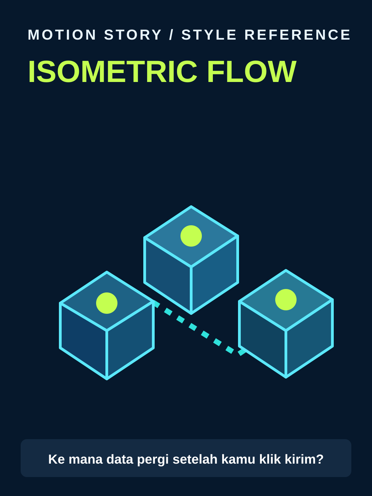

# Isometric Flow



**Style ID:** `isometric-flow`  
**Status:** visual keyframe and motion design reference (not a finished MP4)  
**Best niches:** SaaS, AI systems, business processes  
**Hook mechanism:** show-system-outcome

## Art direction

**Palette:** #06182C, #30E1DB, #C4FF50, #EDF8FF.  
**Recurring visual motif:** connected-isometric-modules.  
**Motion signature:** camera travels along a visible input-process-output route.

Use the [gallery illustration](../../assets/styles/isometric-flow.svg) as a visual style reference, **not** one flat picture to zoom and fade. Rebuild its component shapes in an original time-based scene using SVG, Canvas, CSS or GSAP with an explicit deterministic timeline.

## Storyboard beats

1. **input** — animate evidence and subjects, connecting this beat to the previous one.
2. **processing** — animate evidence and subjects, connecting this beat to the previous one.
3. **transformation** — animate evidence and subjects, connecting this beat to the previous one.
4. **outcome** — animate evidence and subjects, connecting this beat to the previous one.

## Simple Indonesian hook

> Ke mana data pergi setelah kamu klik kirim?

## Copy-ready agent prompt

```text
Gunakan skill motion-story dengan style Isometric Flow (isometric-flow).
Buat video motion graphic 30 detik format 9:16 (1080x1920)
tentang [TOPIK] untuk penonton Indonesia.
Gunakan assets/styles/isometric-flow.svg sebagai referensi komposisi,
warna, dan identitas visual, bukan sebagai slide statis.
Hook: "Ke mana data pergi setelah kamu klik kirim?"
Gerak utama: camera travels along a visible input-process-output route.
Bangun satu dunia visual yang berkembang secara kontinu;
perlihatkan objek, hubungan, atau bukti baru seiring narasi.
Buat HTML standalone dengan timeline deterministik, pause,
restart, scrub debug dan ?clean=1&t=4.2 untuk render frame.
Sertakan naskah VO dan petunjuk render MP4.
```

## Quality constraints

- Hook must be understandable within the first second.
- Avoid generic title/body/card slideshow transitions and static image-only parallax.
- Maintain readable typography at mobile size and safe areas for UI overlays.
- Label conceptual system diagrams as simplified models.
- Retention improvement is a hypothesis; test against actual channel analytics.

[All styles](../../README.md#style-gallery) · [Motion generation guide](../../docs/MOTION_GUIDE.md)
