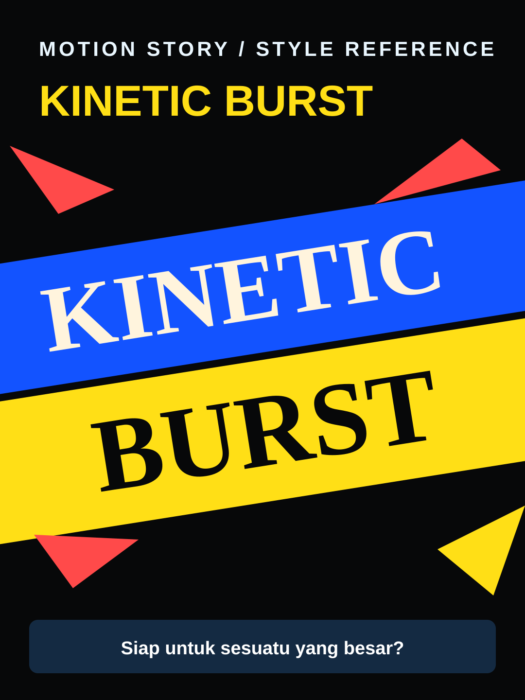

# Kinetic Burst



**Style ID:** `kinetic-burst`  
**Status:** visual keyframe and motion design reference (not a finished MP4)  
**Best niches:** events, music, promos, launches  
**Hook mechanism:** typographic-impact

## Art direction

**Palette:** #070809, #1353FF, #FFDF16, #FF4A4A.  
**Recurring visual motif:** oversized-cropped-words.  
**Motion signature:** per-word slam with masking and asymmetrical exits.

Use the [gallery illustration](../../assets/styles/kinetic-burst.svg) as a visual style reference, **not** one flat picture to zoom and fade. Rebuild its component shapes in an original time-based scene using SVG, Canvas, CSS or GSAP with an explicit deterministic timeline.

## Storyboard beats

1. **instant typographic hit** — animate evidence and subjects, connecting this beat to the previous one.
2. **rhythm escalation** — animate evidence and subjects, connecting this beat to the previous one.
3. **reveal** — animate evidence and subjects, connecting this beat to the previous one.
4. **final punchline** — animate evidence and subjects, connecting this beat to the previous one.

## Simple Indonesian hook

> Siap untuk sesuatu yang besar?

## Copy-ready agent prompt

```text
Gunakan skill motion-story dengan style Kinetic Burst (kinetic-burst).
Buat video motion graphic 30 detik format 9:16 (1080x1920)
tentang [TOPIK] untuk penonton Indonesia.
Gunakan assets/styles/kinetic-burst.svg sebagai referensi komposisi,
warna, dan identitas visual, bukan sebagai slide statis.
Hook: "Siap untuk sesuatu yang besar?"
Gerak utama: per-word slam with masking and asymmetrical exits.
Bangun satu dunia visual yang berkembang secara kontinu;
perlihatkan objek, hubungan, atau bukti baru seiring narasi.
Buat HTML standalone dengan timeline deterministik, pause,
restart, scrub debug dan ?clean=1&t=4.2 untuk render frame.
Sertakan naskah VO dan petunjuk render MP4.
```

## Quality constraints

- Hook must be understandable within the first second.
- Avoid generic title/body/card slideshow transitions and static image-only parallax.
- Maintain readable typography at mobile size and safe areas for UI overlays.
- Avoid photosensitive flashing and keep words legible at phone size.
- Retention improvement is a hypothesis; test against actual channel analytics.

[All styles](../../README.md#style-gallery) · [Motion generation guide](../../docs/MOTION_GUIDE.md)
