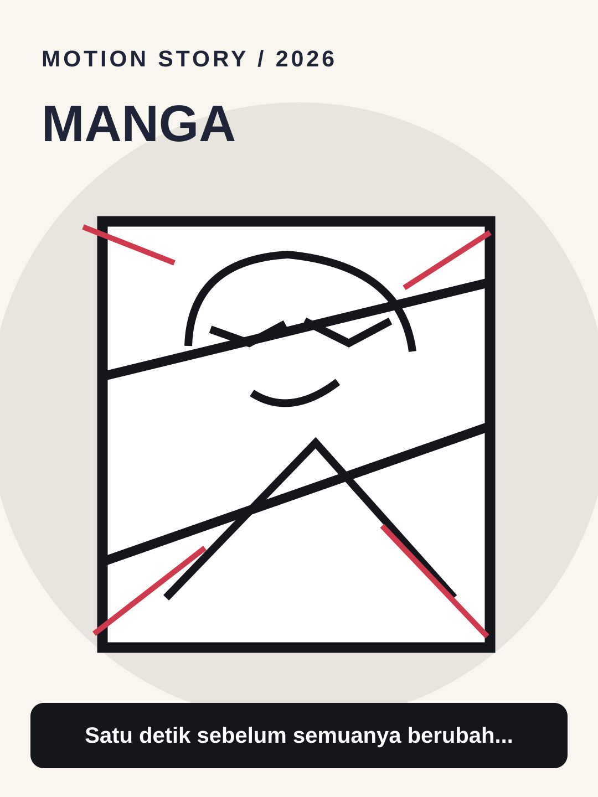

# Manga



**Style ID:** `manga` · **Status:** static visual keyframe and agent motion instructions  
**Niches:** storytelling, anime, action  
**Hook structure:** dramatic-panel

## Visual design system

- Palette: #F8F6EF, #15151C, #CE3B4E, #B8B7B2
- Main visual motif: **inked-panels-and-screentones**
- Signature motion: ink reveals, dramatic pans, cinematic panels
- Use image as art direction and recreate separate animated elements; do not simply zoom a flat reference.

## Scene/beat logic
1. **tension** — move the world or subject in a causally meaningful way.
2. **panels** — move the world or subject in a causally meaningful way.
3. **decisive moment** — move the world or subject in a causally meaningful way.
4. **resolution** — move the world or subject in a causally meaningful way.

## Example hook
> Satu detik sebelum semuanya berubah...

## Simple agent prompt

```text
Gunakan skill motion-story dengan style Manga (manga).
Buat motion graphic berbahasa Indonesia, durasi 30 detik, rasio 9:16.
Topik: [TOPIK]. Audiens: [AUDIENS].
Gunakan assets/styles/manga.svg sebagai referensi gaya visual
dan gerakan: ink reveals, dramatic pans, cinematic panels.
Hook awal: "Satu detik sebelum semuanya berubah..."
Bangun adegan kontinu berbasis bukti, bukan slideshow.
Output: HTML standalone, timeline deterministik, debug scrub, VO script,
dan langkah export MP4. Klaim render MP4 hanya bila benar-benar dilakukan.
```

## Quality / factual safeguards

Do not copy copyrighted manga panels or identifiable protected characters.

Use mobile-safe sizes, original art, deterministic time sampling, and a coherent visual world. The style is a creative reference, not a prediction of virality.

[All styles](../../README.md#style-gallery) · [Motion guide](../../docs/MOTION_GUIDE.md)
