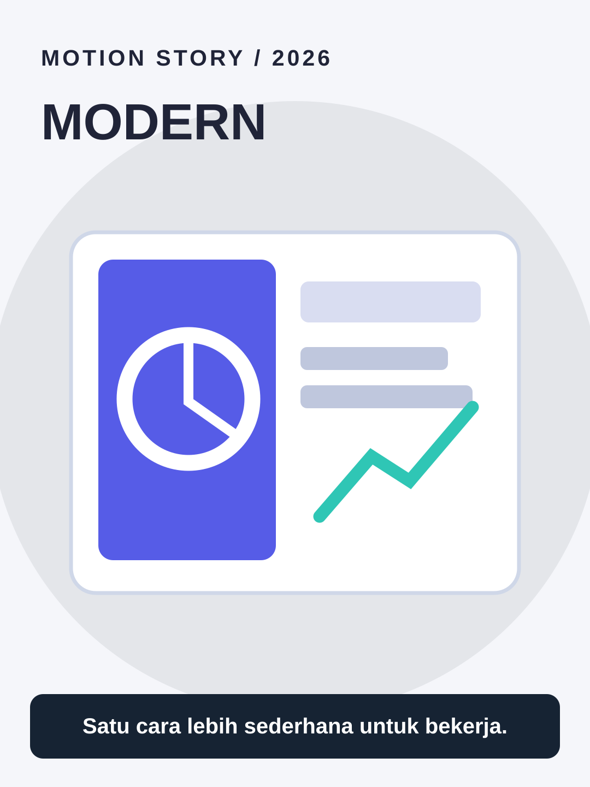

# Modern



**Style ID:** `modern` · **Status:** static visual keyframe and agent motion instructions  
**Niches:** technology, corporate, lifestyle  
**Hook structure:** clean-visual-contrast

## Visual design system

- Palette: #F5F6FA, #162333, #565CE7, #2FC6B5
- Main visual motif: **editorial-geometric-product-grid**
- Signature motion: precision masks, spatial depth and restrained typography
- Use image as art direction and recreate separate animated elements; do not simply zoom a flat reference.

## Scene/beat logic
1. **problem** — move the world or subject in a causally meaningful way.
2. **focus** — move the world or subject in a causally meaningful way.
3. **demonstration** — move the world or subject in a causally meaningful way.
4. **result** — move the world or subject in a causally meaningful way.

## Example hook
> Satu cara lebih sederhana untuk bekerja.

## Simple agent prompt

```text
Gunakan skill motion-story dengan style Modern (modern).
Buat motion graphic berbahasa Indonesia, durasi 30 detik, rasio 9:16.
Topik: [TOPIK]. Audiens: [AUDIENS].
Gunakan assets/styles/modern.svg sebagai referensi gaya visual
dan gerakan: precision masks, spatial depth and restrained typography.
Hook awal: "Satu cara lebih sederhana untuk bekerja."
Bangun adegan kontinu berbasis bukti, bukan slideshow.
Output: HTML standalone, timeline deterministik, debug scrub, VO script,
dan langkah export MP4. Klaim render MP4 hanya bila benar-benar dilakukan.
```

## Quality / factual safeguards

Avoid unsourced marketing claims.

Use mobile-safe sizes, original art, deterministic time sampling, and a coherent visual world. The style is a creative reference, not a prediction of virality.

[All styles](../../README.md#style-gallery) · [Motion guide](../../docs/MOTION_GUIDE.md)
