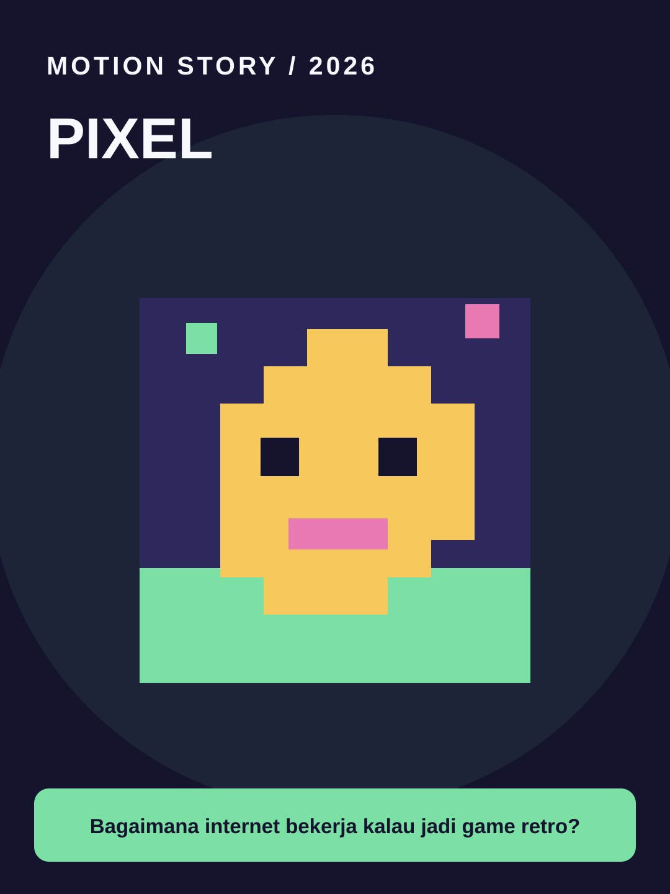

# Pixel



**Style ID:** `pixel` · **Status:** static visual keyframe and agent motion instructions  
**Niches:** retro gaming, coding, education  
**Hook structure:** pixel-world-discovery

## Visual design system

- Palette: #15142E, #7BE0A3, #F7C85B, #E879B2
- Main visual motif: **pixel-tiles-sprite-ui**
- Signature motion: frame stepped sprite and tile scrolls
- Use image as art direction and recreate separate animated elements; do not simply zoom a flat reference.

## Scene/beat logic
1. **spawn** — move the world or subject in a causally meaningful way.
2. **explore** — move the world or subject in a causally meaningful way.
3. **mechanism** — move the world or subject in a causally meaningful way.
4. **level complete** — move the world or subject in a causally meaningful way.

## Example hook
> Bagaimana internet bekerja kalau jadi game retro?

## Simple agent prompt

```text
Gunakan skill motion-story dengan style Pixel (pixel).
Buat motion graphic berbahasa Indonesia, durasi 30 detik, rasio 9:16.
Topik: [TOPIK]. Audiens: [AUDIENS].
Gunakan assets/styles/pixel.svg sebagai referensi gaya visual
dan gerakan: frame stepped sprite and tile scrolls.
Hook awal: "Bagaimana internet bekerja kalau jadi game retro?"
Bangun adegan kontinu berbasis bukti, bukan slideshow.
Output: HTML standalone, timeline deterministik, debug scrub, VO script,
dan langkah export MP4. Klaim render MP4 hanya bila benar-benar dilakukan.
```

## Quality / factual safeguards

Respect strict pixel grid; do not copy commercial game sprites.

Use mobile-safe sizes, original art, deterministic time sampling, and a coherent visual world. The style is a creative reference, not a prediction of virality.

[All styles](../../README.md#style-gallery) · [Motion guide](../../docs/MOTION_GUIDE.md)
