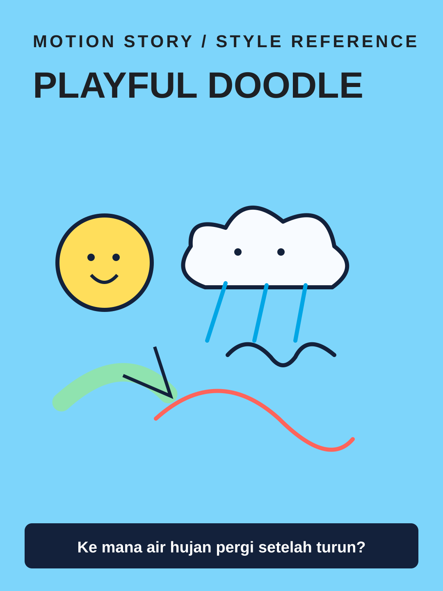

# Playful Doodle



**Style ID:** `playful-doodle`  
**Status:** visual keyframe and motion design reference (not a finished MP4)  
**Best niches:** kids education, fun facts, beginner science  
**Hook mechanism:** friendly-visual-question

## Art direction

**Palette:** #7DD5FB, #FFDE5B, #FF645B, #8FE3AF.  
**Recurring visual motif:** hand-drawn-smiling-objects.  
**Motion signature:** animated marker paths, squash-stretch, character-guided explanation.

Use the [gallery illustration](../../assets/styles/playful-doodle.svg) as a visual style reference, **not** one flat picture to zoom and fade. Rebuild its component shapes in an original time-based scene using SVG, Canvas, CSS or GSAP with an explicit deterministic timeline.

## Storyboard beats

1. **question** — animate evidence and subjects, connecting this beat to the previous one.
2. **character-discovery** — animate evidence and subjects, connecting this beat to the previous one.
3. **animated-causal-loop** — animate evidence and subjects, connecting this beat to the previous one.
4. **simple-answer** — animate evidence and subjects, connecting this beat to the previous one.

## Simple Indonesian hook

> Ke mana air hujan pergi setelah turun?

## Copy-ready agent prompt

```text
Gunakan skill motion-story dengan style Playful Doodle (playful-doodle).
Buat video motion graphic 30 detik format 9:16 (1080x1920)
tentang [TOPIK] untuk penonton Indonesia.
Gunakan assets/styles/playful-doodle.svg sebagai referensi komposisi,
warna, dan identitas visual, bukan sebagai slide statis.
Hook: "Ke mana air hujan pergi setelah turun?"
Gerak utama: animated marker paths, squash-stretch, character-guided explanation.
Bangun satu dunia visual yang berkembang secara kontinu;
perlihatkan objek, hubungan, atau bukti baru seiring narasi.
Buat HTML standalone dengan timeline deterministik, pause,
restart, scrub debug dan ?clean=1&t=4.2 untuk render frame.
Sertakan naskah VO dan petunjuk render MP4.
```

## Quality constraints

- Hook must be understandable within the first second.
- Avoid generic title/body/card slideshow transitions and static image-only parallax.
- Maintain readable typography at mobile size and safe areas for UI overlays.
- Keep child-friendly facts accurate and text readable.
- Retention improvement is a hypothesis; test against actual channel analytics.

[All styles](../../README.md#style-gallery) · [Motion generation guide](../../docs/MOTION_GUIDE.md)
