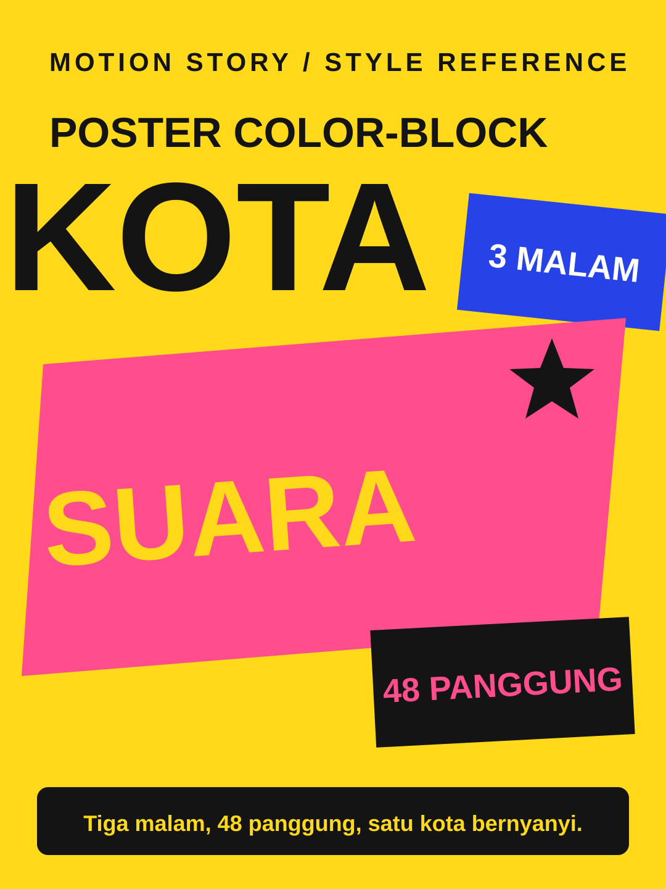

# Poster Color-Block



**Style ID:** `poster-colorblock`  
**Status:** visual keyframe and motion design reference (not a finished MP4)  
**Best niches:** events, music, launches  
**Hook mechanism:** bold-announcement

## Art direction

**Palette:** #FFD91A, #FF4D8D, #2743E8, #141414.  
**Recurring visual motif:** giant-cropped-type-blocks.  
**Motion signature:** solid color fields slam in on the beat; cropped words punch the frame edge.

Use the [gallery illustration](../../assets/styles/poster-colorblock.svg) as a visual style reference, **not** one flat picture to zoom and fade. Rebuild its component shapes in an original time-based scene using SVG, Canvas, CSS or GSAP with an explicit deterministic timeline.

## Storyboard beats

1. **slam** — animate evidence and subjects, connecting this beat to the previous one.
2. **stack** — animate evidence and subjects, connecting this beat to the previous one.
3. **countdown** — animate evidence and subjects, connecting this beat to the previous one.
4. **finale** — animate evidence and subjects, connecting this beat to the previous one.

## Simple Indonesian hook

> Tiga malam, 48 panggung, satu kota bernyanyi.

## Copy-ready agent prompt

```text
Gunakan skill motion-story dengan style Poster Color-Block (poster-colorblock).
Buat video motion graphic 30 detik format 9:16 (1080x1920)
tentang [TOPIK] untuk penonton Indonesia.
Gunakan assets/styles/poster-colorblock.svg sebagai referensi komposisi,
warna, dan identitas visual, bukan sebagai slide statis.
Hook: "Tiga malam, 48 panggung, satu kota bernyanyi."
Gerak utama: solid color fields slam in on the beat; cropped words punch the frame edge.
Bangun satu dunia visual yang berkembang secara kontinu;
perlihatkan objek, hubungan, atau bukti baru seiring narasi.
Buat HTML standalone dengan timeline deterministik, pause,
restart, scrub debug dan ?clean=1&t=4.2 untuk render frame.
Sertakan naskah VO dan petunjuk render MP4.
```

## Quality constraints

- Hook must be understandable within the first second.
- Avoid generic title/body/card slideshow transitions and static image-only parallax.
- Maintain readable typography at mobile size and safe areas for UI overlays.
- Never crop away dates, prices or names that carry the information.
- Retention improvement is a hypothesis; test against actual channel analytics.

[All styles](../../README.md#style-gallery) · [Motion generation guide](../../docs/MOTION_GUIDE.md)
