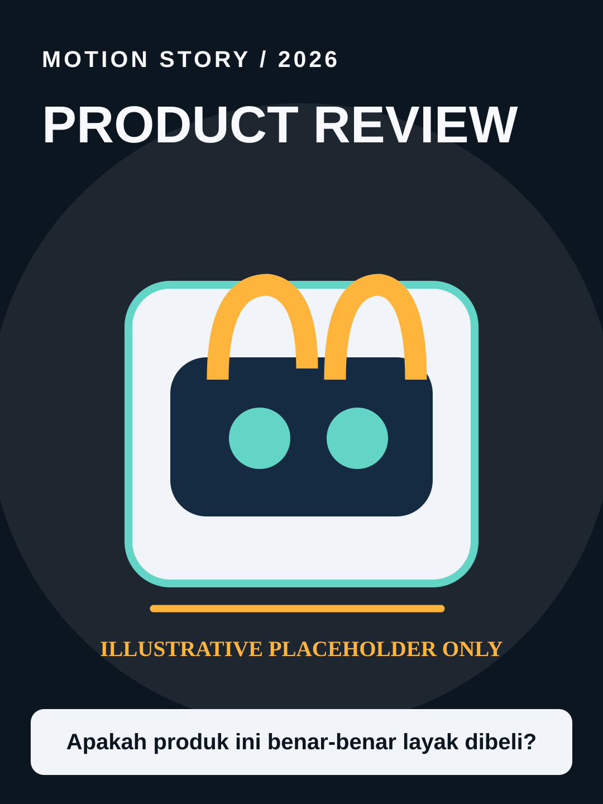

# Product Review



**Style ID:** `product-review` · **Status:** static visual keyframe and agent motion instructions  
**Niches:** reviews, affiliate, consumer tech  
**Hook structure:** real-problem-first

## Visual design system

- Palette: #0C1620, #F1F4F8, #FFB43B, #63D5C7
- Main visual motif: **user-supplied-product-hero**
- Signature motion: product closeups, real demo, labels and pros/cons
- Use image as art direction and recreate separate animated elements; do not simply zoom a flat reference.

## Scene/beat logic
1. **product hook** — move the world or subject in a causally meaningful way.
2. **actual demonstration** — move the world or subject in a causally meaningful way.
3. **pros cons** — move the world or subject in a causally meaningful way.
4. **verdict** — move the world or subject in a causally meaningful way.

## Example hook
> Apakah produk ini benar-benar layak dibeli?

## Simple agent prompt

```text
Gunakan skill motion-story dengan style Product Review (product-review).
Buat motion graphic berbahasa Indonesia, durasi 30 detik, rasio 9:16.
Topik: [TOPIK]. Audiens: [AUDIENS].
Gunakan assets/styles/product-review.svg sebagai referensi gaya visual
dan gerakan: product closeups, real demo, labels and pros/cons.
Hook awal: "Apakah produk ini benar-benar layak dibeli?"
Bangun adegan kontinu berbasis bukti, bukan slideshow.
Output: HTML standalone, timeline deterministik, debug scrub, VO script,
dan langkah export MP4. Klaim render MP4 hanya bila benar-benar dilakukan.
```

## Mandatory product asset gate

**Before generating any finished product review visuals or motion**, check whether the user supplied an actual product photo in the current message or accessible prior context. If missing, **ask for product images and stop production of the final visual/video**. Do not substitute a generic drawing, invented product photo, or unrelated catalog image. If user has supplied photos, do not re-ask. Verify model, feature, price, testing assertions and affiliation; do not claim firsthand experience unless documented. The SVG above is only an abstract style reference, **not an image of the user's product**.

## Quality / factual safeguards

BLOCKING REQUIREMENT: if no product image attached or already provided, ask user to upload product image(s) before generating final product visuals/motion. Do not invent model, appearance, specs, testing or purchase recommendation.

Use mobile-safe sizes, original art, deterministic time sampling, and a coherent visual world. The style is a creative reference, not a prediction of virality.

[All styles](../../README.md#style-gallery) · [Motion guide](../../docs/MOTION_GUIDE.md)
