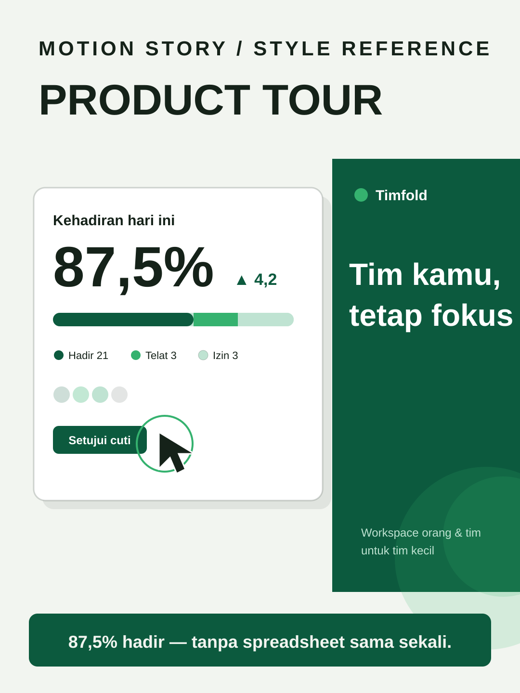

# Product Tour



**Style ID:** `product-tour`  
**Status:** visual keyframe and motion design reference (not a finished MP4)  
**Best niches:** SaaS, dashboards, B2B  
**Hook mechanism:** claim-then-proof

## Art direction

**Palette:** #F2F5F0, #0C5A3E, #35B26F, #152219.  
**Recurring visual motif:** floating-ui-claim-card.  
**Motion signature:** camera zooms into the exact UI element being clicked; claims land beside the interface.

Use the [gallery illustration](../../assets/styles/product-tour.svg) as a visual style reference, **not** one flat picture to zoom and fade. Rebuild its component shapes in an original time-based scene using SVG, Canvas, CSS or GSAP with an explicit deterministic timeline.

## Storyboard beats

1. **claim** — animate evidence and subjects, connecting this beat to the previous one.
2. **zoom** — animate evidence and subjects, connecting this beat to the previous one.
3. **click** — animate evidence and subjects, connecting this beat to the previous one.
4. **result** — animate evidence and subjects, connecting this beat to the previous one.

## Simple Indonesian hook

> 87,5% hadir — tanpa spreadsheet sama sekali.

## Copy-ready agent prompt

```text
Gunakan skill motion-story dengan style Product Tour (product-tour).
Buat video motion graphic 30 detik format 9:16 (1080x1920)
tentang [TOPIK] untuk penonton Indonesia.
Gunakan assets/styles/product-tour.svg sebagai referensi komposisi,
warna, dan identitas visual, bukan sebagai slide statis.
Hook: "87,5% hadir — tanpa spreadsheet sama sekali."
Gerak utama: camera zooms into the exact UI element being clicked; claims land beside the interface.
Bangun satu dunia visual yang berkembang secara kontinu;
perlihatkan objek, hubungan, atau bukti baru seiring narasi.
Buat HTML standalone dengan timeline deterministik, pause,
restart, scrub debug dan ?clean=1&t=4.2 untuk render frame.
Sertakan naskah VO dan petunjuk render MP4.
```

## Quality constraints

- Hook must be understandable within the first second.
- Avoid generic title/body/card slideshow transitions and static image-only parallax.
- Maintain readable typography at mobile size and safe areas for UI overlays.
- Use real product UI or clearly fictional demo data; never present invented metrics as customer results.
- Retention improvement is a hypothesis; test against actual channel analytics.

[All styles](../../README.md#style-gallery) · [Motion generation guide](../../docs/MOTION_GUIDE.md)
