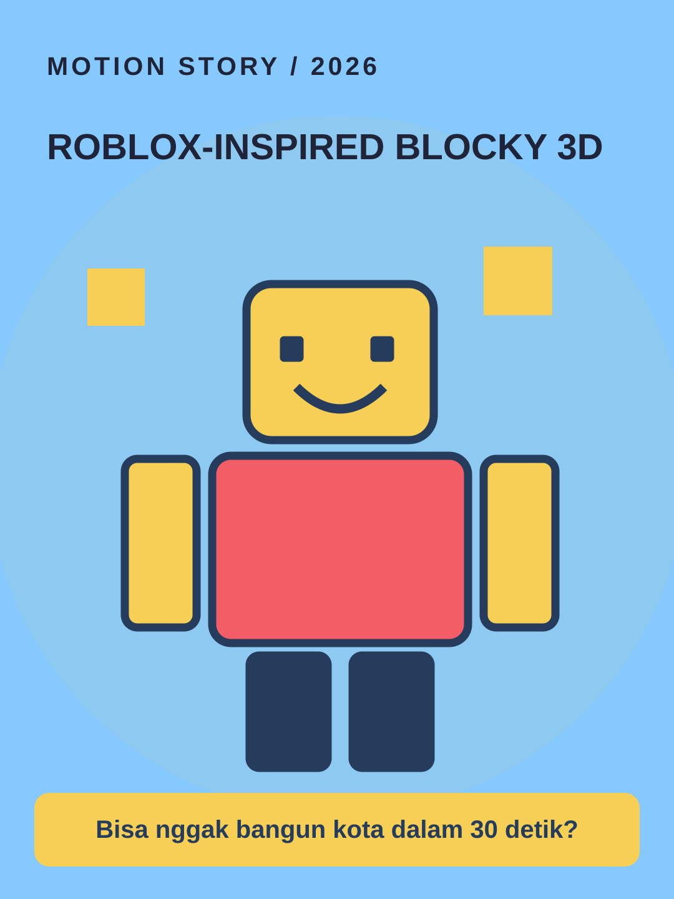

# Roblox-Inspired Blocky 3D



**Style ID:** `roblox` · **Status:** static visual keyframe and agent motion instructions  
**Niches:** gaming, virtual worlds, tutorials  
**Hook structure:** voxel-challenge

## Visual design system

- Palette: #85C9FF, #F8CF55, #F35D65, #253C5D
- Main visual motif: **original-blocky-avatar-voxel-stage**
- Signature motion: rigged block character, snap turns and modular builds
- Use image as art direction and recreate separate animated elements; do not simply zoom a flat reference.

## Scene/beat logic
1. **challenge** — move the world or subject in a causally meaningful way.
2. **world setup** — move the world or subject in a causally meaningful way.
3. **build** — move the world or subject in a causally meaningful way.
4. **result** — move the world or subject in a causally meaningful way.

## Example hook
> Bisa nggak bangun kota dalam 30 detik?

## Simple agent prompt

```text
Gunakan skill motion-story dengan style Roblox-Inspired Blocky 3D (roblox).
Buat motion graphic berbahasa Indonesia, durasi 30 detik, rasio 9:16.
Topik: [TOPIK]. Audiens: [AUDIENS].
Gunakan assets/styles/roblox.svg sebagai referensi gaya visual
dan gerakan: rigged block character, snap turns and modular builds.
Hook awal: "Bisa nggak bangun kota dalam 30 detik?"
Bangun adegan kontinu berbasis bukti, bukan slideshow.
Output: HTML standalone, timeline deterministik, debug scrub, VO script,
dan langkah export MP4. Klaim render MP4 hanya bila benar-benar dilakukan.
```

## Quality / factual safeguards

Use original blocky designs; no implied affiliation with Roblox; do not copy Roblox logos/assets.

Use mobile-safe sizes, original art, deterministic time sampling, and a coherent visual world. The style is a creative reference, not a prediction of virality.

[All styles](../../README.md#style-gallery) · [Motion guide](../../docs/MOTION_GUIDE.md)
