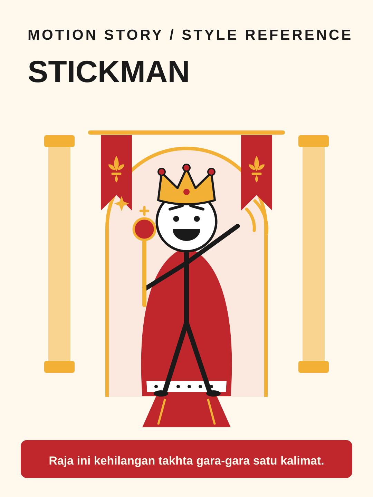

# Stickman



**Style ID:** `stickman`  
**Status:** visual keyframe and motion design reference (not a finished MP4)  
**Best niches:** history, true stories, comedy  
**Hook mechanism:** character-contrast

## Art direction

**Palette:** #FFF8EC, #C0272D, #F2B035, #1A1A1A.  
**Recurring visual motif:** costumed-stick-figure.  
**Motion signature:** stick figures with elastic limbs act out big stories; costumes and props carry the era.

Use the [gallery illustration](../../assets/styles/stickman.svg) as a visual style reference, **not** one flat picture to zoom and fade. Rebuild its component shapes in an original time-based scene using SVG, Canvas, CSS or GSAP with an explicit deterministic timeline.

## Storyboard beats

1. **crown** — animate evidence and subjects, connecting this beat to the previous one.
2. **court** — animate evidence and subjects, connecting this beat to the previous one.
3. **mistake** — animate evidence and subjects, connecting this beat to the previous one.
4. **fall** — animate evidence and subjects, connecting this beat to the previous one.

## Simple Indonesian hook

> Raja ini kehilangan takhta gara-gara satu kalimat.

## Copy-ready agent prompt

```text
Gunakan skill motion-story dengan style Stickman (stickman).
Buat video motion graphic 30 detik format 9:16 (1080x1920)
tentang [TOPIK] untuk penonton Indonesia.
Gunakan assets/styles/stickman.svg sebagai referensi komposisi,
warna, dan identitas visual, bukan sebagai slide statis.
Hook: "Raja ini kehilangan takhta gara-gara satu kalimat."
Gerak utama: stick figures with elastic limbs act out big stories; costumes and props carry the era.
Bangun satu dunia visual yang berkembang secara kontinu;
perlihatkan objek, hubungan, atau bukti baru seiring narasi.
Buat HTML standalone dengan timeline deterministik, pause,
restart, scrub debug dan ?clean=1&t=4.2 untuk render frame.
Sertakan naskah VO dan petunjuk render MP4.
```

## Quality constraints

- Hook must be understandable within the first second.
- Avoid generic title/body/card slideshow transitions and static image-only parallax.
- Maintain readable typography at mobile size and safe areas for UI overlays.
- Stick figures must stay expressive at mobile size; historical claims still need fact-checking.
- Retention improvement is a hypothesis; test against actual channel analytics.

[All styles](../../README.md#style-gallery) · [Motion generation guide](../../docs/MOTION_GUIDE.md)
