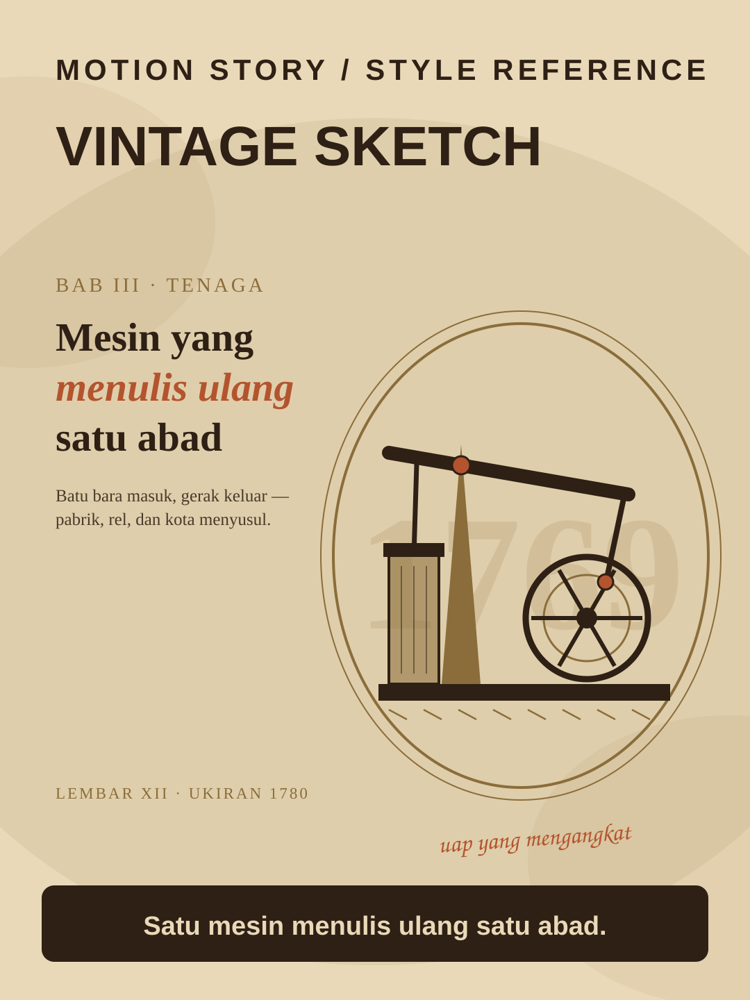

# Vintage Sketch



**Style ID:** `vintage-sketch`  
**Status:** visual keyframe and motion design reference (not a finished MP4)  
**Best niches:** history, biography, education  
**Hook mechanism:** chapter-reveal

## Art direction

**Palette:** #E9D9B8, #8A6D3B, #B3542E, #2E2015.  
**Recurring visual motif:** engraved-chapter-plate.  
**Motion signature:** engraved lines draw themselves; chapter plates turn like the pages of an old book.

Use the [gallery illustration](../../assets/styles/vintage-sketch.svg) as a visual style reference, **not** one flat picture to zoom and fade. Rebuild its component shapes in an original time-based scene using SVG, Canvas, CSS or GSAP with an explicit deterministic timeline.

## Storyboard beats

1. **chapter** — animate evidence and subjects, connecting this beat to the previous one.
2. **machine** — animate evidence and subjects, connecting this beat to the previous one.
3. **spread** — animate evidence and subjects, connecting this beat to the previous one.
4. **legacy** — animate evidence and subjects, connecting this beat to the previous one.

## Simple Indonesian hook

> Satu mesin menulis ulang satu abad.

## Copy-ready agent prompt

```text
Gunakan skill motion-story dengan style Vintage Sketch (vintage-sketch).
Buat video motion graphic 30 detik format 9:16 (1080x1920)
tentang [TOPIK] untuk penonton Indonesia.
Gunakan assets/styles/vintage-sketch.svg sebagai referensi komposisi,
warna, dan identitas visual, bukan sebagai slide statis.
Hook: "Satu mesin menulis ulang satu abad."
Gerak utama: engraved lines draw themselves; chapter plates turn like the pages of an old book.
Bangun satu dunia visual yang berkembang secara kontinu;
perlihatkan objek, hubungan, atau bukti baru seiring narasi.
Buat HTML standalone dengan timeline deterministik, pause,
restart, scrub debug dan ?clean=1&t=4.2 untuk render frame.
Sertakan naskah VO dan petunjuk render MP4.
```

## Quality constraints

- Hook must be understandable within the first second.
- Avoid generic title/body/card slideshow transitions and static image-only parallax.
- Maintain readable typography at mobile size and safe areas for UI overlays.
- Dates, inventors and quotations must be fact-checked; label reconstructed scenes.
- Retention improvement is a hypothesis; test against actual channel analytics.

[All styles](../../README.md#style-gallery) · [Motion generation guide](../../docs/MOTION_GUIDE.md)
