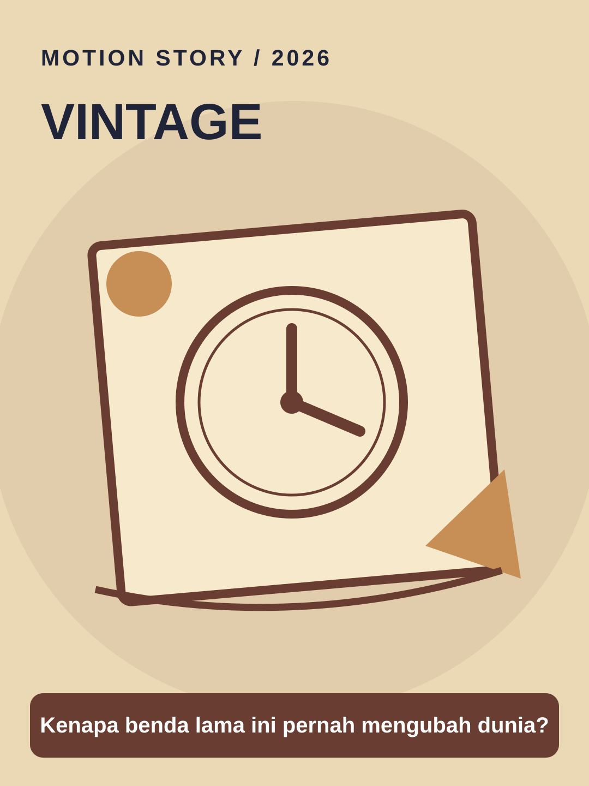

# Vintage



**Style ID:** `vintage` · **Status:** static visual keyframe and agent motion instructions  
**Niches:** history, nostalgia, heritage  
**Hook structure:** lost-history-reveal

## Visual design system

- Palette: #EBD9B5, #693D31, #C78E55, #2B2926
- Main visual motif: **aged-postcard-clock-stamp**
- Signature motion: paper unfolding, archival parallax, inked annotations
- Use image as art direction and recreate separate animated elements; do not simply zoom a flat reference.

## Scene/beat logic
1. **artifact** — move the world or subject in a causally meaningful way.
2. **history** — move the world or subject in a causally meaningful way.
3. **reveal** — move the world or subject in a causally meaningful way.
4. **legacy** — move the world or subject in a causally meaningful way.

## Example hook
> Kenapa benda lama ini pernah mengubah dunia?

## Simple agent prompt

```text
Gunakan skill motion-story dengan style Vintage (vintage).
Buat motion graphic berbahasa Indonesia, durasi 30 detik, rasio 9:16.
Topik: [TOPIK]. Audiens: [AUDIENS].
Gunakan assets/styles/vintage.svg sebagai referensi gaya visual
dan gerakan: paper unfolding, archival parallax, inked annotations.
Hook awal: "Kenapa benda lama ini pernah mengubah dunia?"
Bangun adegan kontinu berbasis bukti, bukan slideshow.
Output: HTML standalone, timeline deterministik, debug scrub, VO script,
dan langkah export MP4. Klaim render MP4 hanya bila benar-benar dilakukan.
```

## Quality / factual safeguards

Credit archives and label reconstructions.

Use mobile-safe sizes, original art, deterministic time sampling, and a coherent visual world. The style is a creative reference, not a prediction of virality.

[All styles](../../README.md#style-gallery) · [Motion guide](../../docs/MOTION_GUIDE.md)
