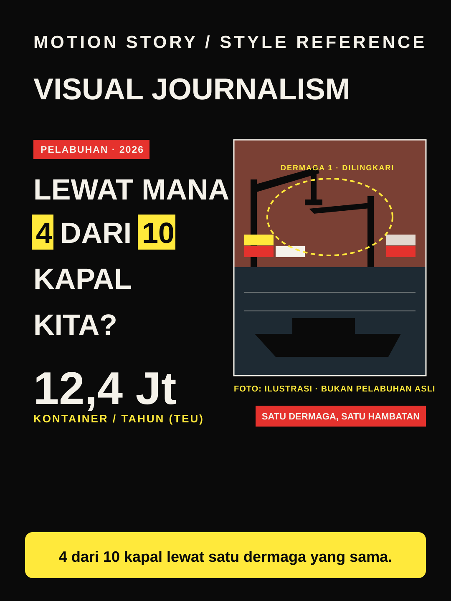

# Visual Journalism



**Style ID:** `visual-journalism`  
**Status:** visual keyframe and motion design reference (not a finished MP4)  
**Best niches:** news, current issues, documentary  
**Hook mechanism:** evidence-reveal

## Art direction

**Palette:** #0A0A0A, #FFE93B, #E5322D, #F5F2EA.  
**Recurring visual motif:** annotated-photo-evidence.  
**Motion signature:** photos land on black; highlighter strokes and dashed circles trace the evidence.

Use the [gallery illustration](../../assets/styles/visual-journalism.svg) as a visual style reference, **not** one flat picture to zoom and fade. Rebuild its component shapes in an original time-based scene using SVG, Canvas, CSS or GSAP with an explicit deterministic timeline.

## Storyboard beats

1. **headline** — animate evidence and subjects, connecting this beat to the previous one.
2. **photo** — animate evidence and subjects, connecting this beat to the previous one.
3. **annotate** — animate evidence and subjects, connecting this beat to the previous one.
4. **number** — animate evidence and subjects, connecting this beat to the previous one.

## Simple Indonesian hook

> 4 dari 10 kapal lewat satu dermaga yang sama.

## Copy-ready agent prompt

```text
Gunakan skill motion-story dengan style Visual Journalism (visual-journalism).
Buat video motion graphic 30 detik format 9:16 (1080x1920)
tentang [TOPIK] untuk penonton Indonesia.
Gunakan assets/styles/visual-journalism.svg sebagai referensi komposisi,
warna, dan identitas visual, bukan sebagai slide statis.
Hook: "4 dari 10 kapal lewat satu dermaga yang sama."
Gerak utama: photos land on black; highlighter strokes and dashed circles trace the evidence.
Bangun satu dunia visual yang berkembang secara kontinu;
perlihatkan objek, hubungan, atau bukti baru seiring narasi.
Buat HTML standalone dengan timeline deterministik, pause,
restart, scrub debug dan ?clean=1&t=4.2 untuk render frame.
Sertakan naskah VO dan petunjuk render MP4.
```

## Quality constraints

- Hook must be understandable within the first second.
- Avoid generic title/body/card slideshow transitions and static image-only parallax.
- Maintain readable typography at mobile size and safe areas for UI overlays.
- Photos need source and date tags; generated imagery must be labeled illustrative, never passed off as news photography.
- Retention improvement is a hypothesis; test against actual channel analytics.

[All styles](../../README.md#style-gallery) · [Motion generation guide](../../docs/MOTION_GUIDE.md)
