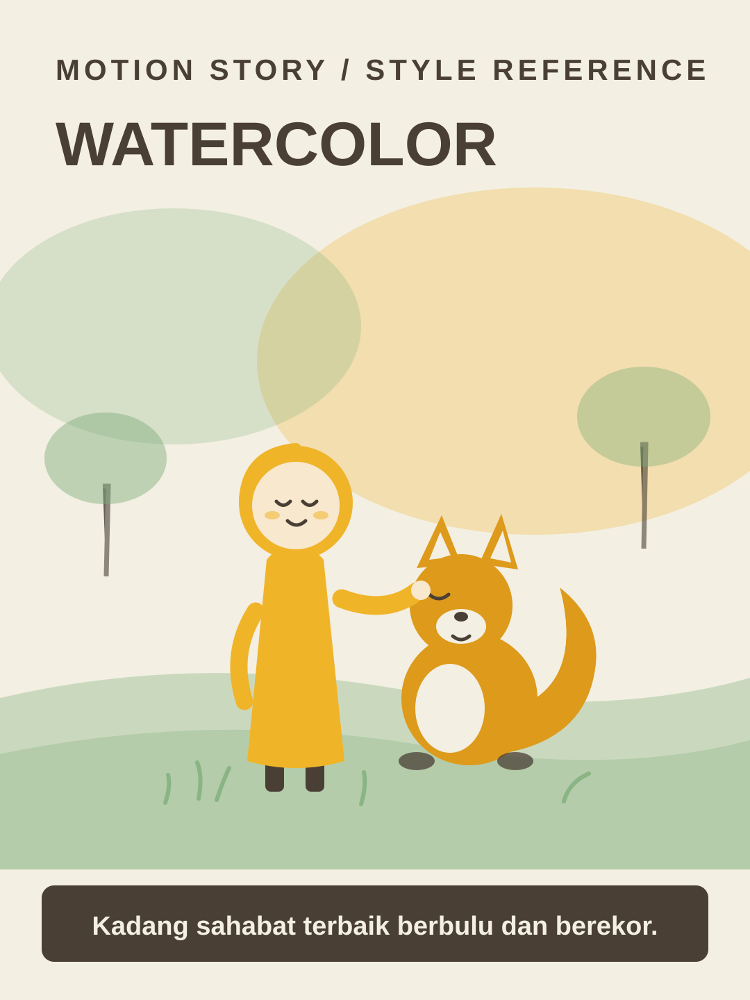

# Watercolor



**Style ID:** `watercolor`  
**Status:** visual keyframe and motion design reference (not a finished MP4)  
**Best niches:** children, family, gentle stories  
**Hook mechanism:** soft-storybook

## Art direction

**Palette:** #F3EFE2, #F0B429, #7FAE7A, #4A3F35.  
**Recurring visual motif:** storybook-watercolor-wash.  
**Motion signature:** paint washes bleed in softly; characters move with storybook gentleness.

Use the [gallery illustration](../../assets/styles/watercolor.svg) as a visual style reference, **not** one flat picture to zoom and fade. Rebuild its component shapes in an original time-based scene using SVG, Canvas, CSS or GSAP with an explicit deterministic timeline.

## Storyboard beats

1. **wash** — animate evidence and subjects, connecting this beat to the previous one.
2. **meet** — animate evidence and subjects, connecting this beat to the previous one.
3. **hug** — animate evidence and subjects, connecting this beat to the previous one.
4. **warmth** — animate evidence and subjects, connecting this beat to the previous one.

## Simple Indonesian hook

> Kadang sahabat terbaik berbulu dan berekor.

## Copy-ready agent prompt

```text
Gunakan skill motion-story dengan style Watercolor (watercolor).
Buat video motion graphic 30 detik format 9:16 (1080x1920)
tentang [TOPIK] untuk penonton Indonesia.
Gunakan assets/styles/watercolor.svg sebagai referensi komposisi,
warna, dan identitas visual, bukan sebagai slide statis.
Hook: "Kadang sahabat terbaik berbulu dan berekor."
Gerak utama: paint washes bleed in softly; characters move with storybook gentleness.
Bangun satu dunia visual yang berkembang secara kontinu;
perlihatkan objek, hubungan, atau bukti baru seiring narasi.
Buat HTML standalone dengan timeline deterministik, pause,
restart, scrub debug dan ?clean=1&t=4.2 untuk render frame.
Sertakan naskah VO dan petunjuk render MP4.
```

## Quality constraints

- Hook must be understandable within the first second.
- Avoid generic title/body/card slideshow transitions and static image-only parallax.
- Maintain readable typography at mobile size and safe areas for UI overlays.
- Soft edges must not blur captions; keep text on clean, unpainted paper areas.
- Retention improvement is a hypothesis; test against actual channel analytics.

[All styles](../../README.md#style-gallery) · [Motion generation guide](../../docs/MOTION_GUIDE.md)
